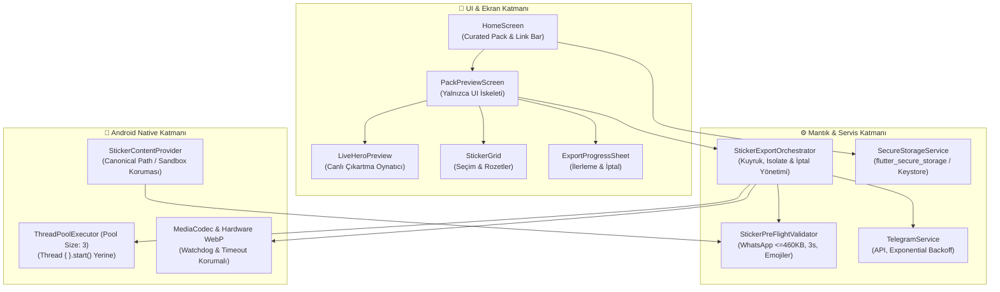

# 🛠️ StickerSwap: Çözüm ve İyileştirme Yol Haritası (FixRoad.md)

> **Tarih:** 12 Kasım 2026  
> **Referans Belge:** [`Savukat.md`](file:///Users/kompetankedi/Documents/GitHub/stickerswap/Savukat.md) (*Şeytanın Avukatı Raporu*)  
> **Hedef:** Prototip / Geliştirici Masası Seviyesinden **Üretim / Mağaza Hazır (Production-Ready) ve Kurumsal Standartlara** Geçiş  
> **Depo:** [Kompetankedi/stickerswap](https://github.com/Kompetankedi/stickerswap)  
> **Mevcut Sürüm:** `v1.0.6+2006` ➔ **Hedeflenen Başlangıç Sürümü:** `v1.0.7+2007`

---

## 📌 İçindekiler
1. [Yönetici Özeti ve Dönüşüm Vizyonu](#1-yönetici-özeti-ve-dönüşüm-vizyonu)
2. [Önceliklendirme ve Risk Matrisi (MoSCoW)](#2-önceliklendirme-ve-risk-matrisi-moscow)
3. [Bütünleşik Mimari Çözüm Şeması (Mermaid)](#3-bütünleşik-mimari-çözüm-şeması)
4. [Faz 0: Acil Güvenlik ve Blocker Düzeltmeleri (P0 - Kritik)](#4-faz-0-acil-güvenlik-ve-blocker-düzeltmeleri-p0---kritik)
   - 4.1 `flutter analyze` ve Bağımlılık Onarımı (`characters`)
   - 4.2 `StickerContentProvider` Path Traversal / Arbitrary File Read Açığının Kapatılması
   - 4.3 Bot Token Güvenliği: `flutter_secure_storage` ve Keystore/Keychain Koruması
   - 4.4 Repodaki Ephemeral (Geçici) Dosyaların Temizliği ve `.gitignore` Sertleştirmesi
5. [Faz 1: Dokümantasyon Şeffaflığı ve Git Hijyeni (P1 - Yüksek)](#5-faz-1-dokümantasyon-şeffaflığı-ve-git-hijyeni-p1---yüksek)
   - 5.1 README.md ve Pazarlama Vaatlerinin Düzeltilmesi
   - 5.2 Git Dalı (Branching) Stratejisi ve SemVer Standardı
   - 5.3 Commit Disiplini (Conventional Commits) ve Git Hook Otomasyonu
   - 5.4 Canlı Kod Log Hijyeni (ProGuard / R8 & Debug Guards)
6. [Faz 2: Mimari Refactoring ve Native Kararlılık (P1 - Yüksek)](#6-faz-2-mimari-refactoring-ve-native-kararlılık-p1---yüksek)
   - 6.1 2257 Satırlık God Class'ın Parçalanması (`pack_preview_screen.dart`)
   - 6.2 Hafif ve Kararlı State Management Mimarisi
   - 6.3 Android Native Thread Havuzu Entegrasyonu (`MainActivity.kt`)
   - 6.4 Medya Kod Çözücü Kararlılığı (VP9 Timeout & Watchdog)
7. [Faz 3: WhatsApp Entegrasyon Sağlamlaştırma ve Hukuki Uyum (P2 - Orta)](#7-faz-3-whatsapp-entegrasyon-sağlamlaştırma-ve-hukuki-uyum-p2---orta)
   - 7.1 WhatsApp "Hep ya da Hiç" Doğrulama Sigortası (`StickerPreFlightValidator`)
   - 7.2 Curated Packs (Popüler Paketler) Özelliğinin Hayata Geçirilmesi
   - 7.3 Hukuki Sorumluluk Reddi (Disclaimer & ToS) ve DMCA Bildirimi
   - 7.4 iOS Desteği Yol Haritası ve Platform Şeffaflığı
8. [Faz 4: Test Mühendisliği ve CI/CD Otomasyonu (P2 - Orta)](#8-faz-4-test-mühendisliği-ve-cicd-otomasyonu-p2---orta)
   - 8.1 Mock HTTP ile Telegram API Hata Senaryoları Test Takımı
   - 8.2 Android Native Katmanı İçin JUnit / Robolectric Testleri
   - 8.3 GitHub Actions CI/CD İş Akışı
9. [Uygulama Takvimi ve Eylem Kontrol Listesi (Checklist)](#9-uygulama-takvimi-ve-eylem-kontrol-listesi)

---

## 1. Yönetici Özeti ve Dönüşüm Vizyonu

[`Savukat.md`](file:///Users/kompetankedi/Documents/GitHub/stickerswap/Savukat.md) dosyasında sunulan denetim raporu; StickerSwap projesinin **görsel işleme, Isolate worker'ları ve dinamik süre koruması** gibi çekirdek algoritmalarda elde ettiği başarıyı takdir etmekle birlikte, projenin **güvenlik, sürdürülebilirlik, kod kalitesi, mağaza gereksinimleri ve hukuki şeffaflık** boyutlarında ciddi teknik borçlar taşıdığını net bir şekilde ortaya koymuştur.

Bu **FixRoad.md** belgesi, raporda tespit edilen tüm zafiyet ve eksiklikleri somut kod seviyesinde çözüme kavuşturmak üzere hazırlanmış **uygulamalı mühendislik yol haritasıdır**.

### Temel Hedefler:
1. **Sıfır Zafiyet:** Cleartext bot token saklama ve ContentProvider path traversal açıklarını kapatmak.
2. **Sıfır Analiz Hatası:** `flutter analyze` ve derleme boru hatlarını temizlemek.
3. **Sürdürülebilir Mimari:** 2257 satırlık God Screen'i modüler, test edilebilir 4 ana bileşene ayırmak.
4. **Android Native Kararlılık:** Kontrolsüz `Thread { }.start()` yerine kontrollü `ExecutorService` havuzuna geçmek.
5. **Dürüst Kullanıcı Deneyimi:** Dokümantasyon ile kod arasındaki tutarsızlıkları gidermek, hayalet özellikleri UI'a kazandırmak.

---

## 2. Önceliklendirme ve Risk Matrisi (MoSCoW)

| Öncelik | Seviye | Kapsam | Tahmini Süre | Kritiklik / Risk Sebebi |
| :--- | :---: | :--- | :---: | :--- |
| **P0 (Must Have)** | 🔴 Acil | Güvenlik Açıkları, `flutter analyze` patlaması, Ephemeral temizliği | 1-2 Gün | CI/CD engeli, veri çalınma riski, arbitrary file read. |
| **P1 (Should Have)** | 🟡 Yüksek | Mimari refactoring (God class), Native ThreadPool, Git hijyeni | 3-5 Gün | Kod bakımının tıkanması, zombie thread sızıntıları, bellek şişmesi. |
| **P2 (Could Have)** | 🟢 Orta | Curated Packs UI, Pre-flight validator, Mock testler, Hukuki ToS | 2-3 Gün | Kullanıcı deneyimi, WhatsApp doğrulama güvenliği, telif koruması. |
| **P3 (Future)** | ⚪ Gelecek | iOS Native Swift Export, Cloudless P2P paylaşım | Gelecek Sürüm | iOS cihazlara doğrudan WhatsApp çıkartma desteği. |

---

## 3. Bütünleşik Mimari Çözüm Şeması

Aşağıdaki şema, mevcut monolitik yapının nasıl ayrıştırılacağını ve güvenlik katmanlarının nereye entegre edileceğini göstermektedir:



---

## 4. Faz 0: Acil Güvenlik ve Blocker Düzeltmeleri (P0 - Kritik)

### 4.1. `flutter analyze` ve Bağımlılık Onarımı (`characters`)
- **İlgili Rapor Maddesi:** [`Savukat.md` Madde 4](file:///Users/kompetankedi/Documents/GitHub/stickerswap/Savukat.md#4-statik-analiz-ve-bağımlılık-ihlali)
- **Sorun:** [`lib/services/whatsapp_service.dart`](file:///Users/kompetankedi/Documents/GitHub/stickerswap/lib/services/whatsapp_service.dart#L2) dosyasında `import 'package:characters/characters.dart';` kullanılmakta ancak [`pubspec.yaml`](file:///Users/kompetankedi/Documents/GitHub/stickerswap/pubspec.yaml) içinde doğrudan bağımlılık olarak listelenmemektedir.
- **Çözüm Adımları:**
  1. [`pubspec.yaml`](file:///Users/kompetankedi/Documents/GitHub/stickerswap/pubspec.yaml) dosyasına `characters: ^1.3.0` eklenmeli.
  2. `flutter pub get` ve `flutter analyze --fatal-infos` çalıştırılarak sıfır uyarı teyit edilmeli.

```yaml
# pubspec.yaml
dependencies:
  flutter:
    sdk: flutter
  characters: ^1.3.0 # <-- DOĞRUDAN EKLENMELİ
  cupertino_icons: ^1.0.8
  http: ^1.6.0
  # ... diğer paketler ...
```

---

### 4.2. `StickerContentProvider` Path Traversal / Arbitrary File Read Açığının Kapatılması
- **İlgili Rapor Maddesi:** [`Savukat.md` Madde 8.2](file:///Users/kompetankedi/Documents/GitHub/stickerswap/Savukat.md#82-stickercontentprovider-üzerinde-potansiyel-dosya-okuma-açığı-arbitrary-file-read)
- **Sorun:** [`StickerContentProvider.kt`](file:///Users/kompetankedi/Documents/GitHub/stickerswap/android/app/src/main/kotlin/com/example/stickerswap/whatsapp/StickerContentProvider.kt#L138-L151) içindeki `resolveAssetFile` metodu, gelen dosya adı `/` ile başladığında veya URI parametresi verildiğinde hiçbir sınır kontrolü yapmadan doğrudan diski okumaktadır (`if (direct.exists()) return direct`). `android:exported="true"` olduğundan, cihazdaki herhangi bir zararlı uygulama uygulamanın özel XML veya veritabanı dosyalarını talep edebilir.
- **Uygulanacak Çözüm:**
  - Sandboxing kuralı uygulanmalıdır: Döndürülecek dosyanın `canonicalPath` değeri, uygulamanın kendi `context.filesDir` veya `context.cacheDir` dizinleri altında olmak **zorundadır**.
  - `shared_prefs`, `databases` ve sistem kök dizini erişimleri anında `SecurityException` veya `null` ile reddedilmelidir.

```kotlin
// android/app/src/main/kotlin/com/example/stickerswap/whatsapp/StickerContentProvider.kt

private fun isPathSandboxed(context: Context, file: File): Boolean {
    return try {
        val canonical = file.canonicalPath
        val allowedDirs = listOfNotNull(
            context.filesDir?.canonicalPath,
            context.cacheDir?.canonicalPath,
            context.getExternalFilesDir(null)?.canonicalPath
        )
        // Hassas dizinleri kara listeye al
        val forbiddenSubstrings = listOf(
            File.separator + "shared_prefs",
            File.separator + "databases",
            File.separator + "no_backup"
        )
        val inAllowedDir = allowedDirs.any { allowed -> canonical.startsWith(allowed + File.separator) || canonical == allowed }
        val notForbidden = forbiddenSubstrings.none { forbidden -> canonical.contains(forbidden) }
        
        inAllowedDir && notForbidden
    } catch (_: Exception) {
        false
    }
}
```
`resolveAssetFile` fonksiyonunun her çıkış noktasına `if (!isPathSandboxed(context, candidateFile)) return null` kontrolü yerleştirilecektir.

---

### 4.3. Bot Token Güvenliği: `flutter_secure_storage` Entegrasyonu
- **İlgili Rapor Maddesi:** [`Savukat.md` Madde 8.1](file:///Users/kompetankedi/Documents/GitHub/stickerswap/Savukat.md#81-telegram-bot-tokenın-düz-metin-plain-text-saklanması)
- **Sorun:** Telegram Bot Token, [`lib/services/storage_service.dart`](file:///Users/kompetankedi/Documents/GitHub/stickerswap/lib/services/storage_service.dart#L33-L41) içinde `SharedPreferences` ile düz metin (XML) olarak saklanmaktadır. Rootlu cihazlarda veya ADB backup ile kolayca ele geçirilebilir.
- **Uygulanacak Çözüm:**
  1. [`pubspec.yaml`](file:///Users/kompetankedi/Documents/GitHub/stickerswap/pubspec.yaml) dosyasına `flutter_secure_storage: ^9.2.2` eklenecektir.
  2. `StorageService` içinde `_secureStorage` örneği oluşturulacak, token Android Keystore / iOS Keychain ile şifrelenecektir.
  3. **Kullanıcı Kaybını Önleyen Otomatik Geçiş (Migration):** Eğer `SharedPreferences` içinde eski token varsa, otomatik olarak okunup `flutter_secure_storage`'a yazılacak ve eski açık metin XML'den silinecektir.

```dart
// lib/services/storage_service.dart
import 'package:flutter_secure_storage/flutter_secure_storage.dart';

class StorageService {
  static const String _keyBotToken = 'bot_token';
  final FlutterSecureStorage _secureStorage = const FlutterSecureStorage(
    aOptions: AndroidOptions(encryptedSharedPreferences: true),
  );

  /// Geriye dönük uyumlu ve güvenli token okuma
  Future<String?> getBotToken() async {
    // 1. Önce güvenli depodan oku
    String? token = await _secureStorage.read(key: _keyBotToken);
    if (token != null && token.isNotEmpty) return token;

    // 2. Güvenli depoda yoksa eski SharedPreferences'tan kontrol et (Migration)
    final legacyToken = _prefs.getString(_keyBotToken);
    if (legacyToken != null && legacyToken.isNotEmpty) {
      await _secureStorage.write(key: _keyBotToken, value: legacyToken);
      await _prefs.remove(_keyBotToken); // Açık metni hemen sil!
      return legacyToken;
    }
    return null;
  }

  Future<void> setBotToken(String token) async {
    await _secureStorage.write(key: _keyBotToken, value: token);
    await _prefs.remove(_keyBotToken); // Eski yerde kalmadığından emin ol
  }

  Future<void> clearBotToken() async {
    await _secureStorage.delete(key: _keyBotToken);
    await _prefs.remove(_keyBotToken);
  }
}
```

---

### 4.4. Repodaki Ephemeral (Geçici) Dosyaların Temizliği ve `.gitignore` Sertleştirmesi
- **İlgili Rapor Maddesi:** [`Savukat.md` Madde 2.4](file:///Users/kompetankedi/Documents/GitHub/stickerswap/Savukat.md#24-yetersiz-gitignore-ve-repoya-sızan-çöp-dosyalar-ephemeral-artifacts)
- **Sorun:** `macos/Flutter/ephemeral/` ve `linux/flutter/generated_*` altındaki 14 adet geçici derleme çıktısı Git takibindedir.
- **Eylem Planı:**
  1. `git rm -r --cached macos/Flutter/ephemeral/`
  2. `git rm --cached linux/flutter/generated_*`
  3. [`.gitignore`](file:///Users/kompetankedi/Documents/GitHub/stickerswap/.gitignore) dosyasına aşağıdaki kuralları eklemek:

```gitignore
# Ephemeral & Platform build artifacts
**/macos/Flutter/ephemeral/
**/linux/flutter/generated_*
**/macos/Flutter/GeneratedPluginRegistrant.swift
*.lock
!pubspec.lock
.swiftpm/
```

---

## 5. Faz 1: Dokümantasyon Şeffaflığı ve Git Hijyeni (P1 - Yüksek)

### 5.1. README.md ve Pazarlama Vaatlerinin Düzeltilmesi
- **İlgili Rapor Maddesi:** [`Savukat.md` Madde 3.1 & 3.3](file:///Users/kompetankedi/Documents/GitHub/stickerswap/Savukat.md#31-uygulama-hazır-gelir-yanılgısı-boş-token-gerçeği)
- **Sorun:** [`README.md`](file:///Users/kompetankedi/Documents/GitHub/stickerswap/README.md) dosyasında *"Uygulama hazır olarak gelir"* ve *"Popüler Paketler Keşfi"* denmekte; ancak bot token olmadan indirme çalışmamakta ve CuratedPack ekranda bulunmamaktadır.
- **Eylem Adımları:**
  1. README içerisindeki *"Uygulama hazır olarak gelir"* ifadesi kaldırılacak. Telegram'ın açık API politikası gereği kullanıcıların **1 dakikada ücretsiz kendi bot token'larını eklemeleri gerektiği** görsel bir rehber ile dürüstçe vurgulanacak.
  2. Platform desteği tablosu eklenecek:
     - Android: Tam Destek (WhatsApp & WhatsApp Business) ✅
     - iOS: Çıkartma önizleme desteği aktif; WhatsApp doğrudan aktarım protokolü geliştirme aşamasında ⏳
  3. İlk açılışta kullanıcının karşısına token yoksa kırmızı hata yerine dostane bir **"İlk Kurulum Sihirbazı" (Setup Banner / Sheet)** çıkarılacak.

---

### 5.2. Git Dalı (Branching) Stratejisi ve SemVer Standardı
- **İlgili Rapor Maddesi:** [`Savukat.md` Madde 2.1 & 2.3](file:///Users/kompetankedi/Documents/GitHub/stickerswap/Savukat.md#21-branch-stratejisinin-yokluğu-her-şey-main-üzerinde-canlı-ameliyat)
- **Sorun:** Başarısız denemeler bile doğrudan `main` branch'ine commitlenmiş; Git tag'leri `V1`, `V1.0.1`, `v1.0.6` şeklinde tutarsızdır.
- **Uygulanacak Kural Seti:**
  1. **Branch Modeli:**
     - `main`: Yalnızca testlerden geçmiş, hatasız üretim sürümleri.
     - `develop`: Aktif geliştirme dalı.
     - `feature/<özellik-adı>`: Yeni özellikler (örn. `feature/curated-packs-ui`).
     - `fix/<hata-tanımı>`: Hata düzeltmeleri (örn. `fix/content-provider-traversal`).
  2. **SemVer Standartlaştırması:**
     - Tüm Git etiketleri kesinlikle küçük `v` harfi ve 3 hane formatında (`v1.0.7`, `v1.0.8`) olacaktır.
     - `pubspec.yaml` versiyon numarası her yeni sürümde `version: 1.0.7+2007` olarak bir artırılacaktır.

---

### 5.3. Commit Disiplini (Conventional Commits)
- **İlgili Rapor Maddesi:** [`Savukat.md` Madde 2.2](file:///Users/kompetankedi/Documents/GitHub/stickerswap/Savukat.md#22-commit-mesajlarındaki-disiplinsizlik-ve-dil-çorbası)
- **Standart Format:** `<type>(<scope>): <subject>`
  - `feat(curated)`: add popular packs carousel to home screen
  - `fix(security)`: sandbox file access in StickerContentProvider
  - `refactor(export)`: extract export orchestrator from pack preview screen
  - `chore(deps)`: add characters package to pubspec.yaml
  - `docs(readme)`: clarify telegram bot token requirement

---

### 5.4. Canlı Kod Log Hijyeni (ProGuard / R8 & Debug Guards)
- **İlgili Rapor Maddesi:** [`Savukat.md` Madde 8.3](file:///Users/kompetankedi/Documents/GitHub/stickerswap/Savukat.md#83-canlı-kodda-kalan-debug-logları)
- **Sorun:** `MainActivity.kt` ve `StickerContentProvider.kt` dosyalarındaki `Log.d` ve `Log.i` çağrıları kullanıcı hash ve dosya yollarını logcat'e basmaktadır.
- **Eylem Adımları:**
  1. Kotlin tarafında `if (BuildConfig.DEBUG)` sarmalayıcısı kullanılacak ya da `proguard-rules.pro` içerisine log kaldırma kuralı eklenecektir:
     ```proguard
     -assumenosideeffects class android.util.Log {
         public static *** d(...);
         public static *** v(...);
         public static *** i(...);
     }
     ```
  2. Dart tarafında `print` yerine `debugPrint` veya `kDebugMode` kullanılacaktır.

---

## 6. Faz 2: Mimari Refactoring ve Native Kararlılık (P1 - Yüksek)

### 6.1. 2257 Satırlık God Class'ın Parçalanması (`pack_preview_screen.dart`)
- **İlgili Rapor Maddesi:** [`Savukat.md` Madde 5.1](file:///Users/kompetankedi/Documents/GitHub/stickerswap/Savukat.md#51-2257-satırlık-devasa-god-screen-packpreveiwscreen)
- **Sorun:** Tek bir State sınıfı içinde 9 farklı sorumluluk iç içe geçmiştir.
- **Ayrıştırma Mimarisi:**

```text
lib/
├── screens/
│   └── pack_preview_screen.dart         <-- Yalnızca 250 satır: Ekran iskeleti ve AppBar
├── services/
│   └── sticker_export_orchestrator.dart  <-- İndirme, Isolate havuzu, çok parçalı bölme mantığı
└── widgets/
    ├── live_hero_preview.dart           <-- Seçili çıkartmanın canlı 512x512 animasyon oynatıcısı
    ├── sticker_selection_grid.dart      <-- Izgara görünümü, çoklu seçim, animasyon rozetleri
    └── export_progress_sheet.dart       <-- İlerleme çubuğu, yüzde hesabı ve iptal butonu
```

- **Sorumluluk Dağılımı:**
  1. **`StickerExportOrchestrator`:** `ChangeNotifier` genişleterek `exportState` (hazırlanıyor, dönüştürülüyor, tamamlandı, hata) durumlarını dışarıya yayınlar. UI sadece bu durumu dinler.
  2. **`LiveHeroPreview`:** Tıklanan çıkartmanın WebM/Lottie/WebP verisini izole şekilde render eder.
  3. **`StickerSelectionGrid`:** Çıkartmaların seçilme durumunu ve 1-30 limit kontrollerini yönetir.

---

### 6.2. Hafif ve Kararlı State Management Mimarisi
- Ekran genelinde kontrolsüz `setState()` çağrıları yerine, reaktif ve izole UI yenilemesi sağlayan `ValueNotifier` / `ChangeNotifier` veya `flutter_bloc` / `riverpod` yaklaşımına geçilecektir.
- UI ana thread'i sadece gerekli bileşenleri (örneğin sadece ilerleme çubuğunu veya sadece seçili kartı) yeniden çizecektir.

---

### 6.3. Android Native Thread Havuzu Entegrasyonu (`MainActivity.kt`)
- **İlgili Rapor Maddesi:** [`Savukat.md` Madde 5.3](file:///Users/kompetankedi/Documents/GitHub/stickerswap/Savukat.md#53-android-mainactivitykt-içinde-kontrolsüz-thread-spawn)
- **Sorun:** Her kare ayıklama ve statik sıkıştırma isteğinde doğrudan `Thread { }.start()` açılmakta; zombie thread sızıntısına yol açmaktadır.
- **Uygulanacak Çözüm:**
  - `MainActivity.kt` sınıfında sabit 3 iş parçacıklı bir `ExecutorService` tanımlanacaktır (`Executors.newFixedThreadPool(3)`).
  - Activity `onDestroy` edildiğinde havuz güvenli şekilde kapatılacaktır (`executor.shutdownNow()`).

```kotlin
// android/app/src/main/kotlin/com/example/stickerswap/MainActivity.kt

class MainActivity : FlutterActivity() {
    // Sabit 3 iş parçacıklı CPU/Media havuzu
    private val mediaExecutor: ExecutorService = Executors.newFixedThreadPool(3)

    override fun configureFlutterEngine(flutterEngine: FlutterEngine) {
        super.configureFlutterEngine(flutterEngine)

        MethodChannel(flutterEngine.dartExecutor.binaryMessenger, CHANNEL).setMethodCallHandler { call, result ->
            when (call.method) {
                "extractFrames" -> {
                    val videoPath = call.argument<String>("videoPath") ?: return@setMethodCallHandler result.error("ARG_NULL", "videoPath null", null)
                    val fps = call.argument<Int>("fps") ?: 8
                    val maxFrames = call.argument<Int>("maxFrames") ?: 22

                    mediaExecutor.execute {
                        val response = extractVideoFrames(videoPath, fps, maxFrames)
                        runOnUiThread { result.success(response) }
                    }
                }
                "compressStaticWebP" -> {
                    val inputPath = call.argument<String>("inputPath")
                    val outputPath = call.argument<String>("outputPath")
                    if (inputPath == null || outputPath == null) return@setMethodCallHandler result.error("ARG_NULL", "Paths null", null)

                    mediaExecutor.execute {
                        val ok = compressStaticWebPFile(inputPath, outputPath)
                        runOnUiThread { result.success(ok) }
                    }
                }
            }
        }
    }

    override fun onDestroy() {
        super.onDestroy()
        mediaExecutor.shutdownNow()
    }
}
```

---

### 6.4. Medya Kod Çözücü Kararlılığı (VP9 Timeout & Watchdog)
- **İlgili Rapor Maddesi:** [`Savukat.md` Madde 6.1 & 6.2](file:///Users/kompetankedi/Documents/GitHub/stickerswap/Savukat.md#61-webmvp9-donanım-kod-çözücü-çıkmazı)
- **Sorun:** MediaCodec kilitlendiğinde 1000 iterasyonluk idle bekleme cihazı ısıtmakta; MediaTek yonga setlerinde sıra genişliği (rowStride) NV21 renk kayması yaratabilmektedir.
- **Uygulanacak Çözüm:**
  - `dequeueOutputBuffer` bekleme süresi maksimum 1.5 saniye watchdog süresi ile sınırlandırılacak. Zaman aşımına uğrarsa hemen yazılımsal kod çözücüye (`preferSoftware = true`) düşülecektir.
  - `ImageFormat.YUV_420_888` düzleminden `NV21`'e dönüşümde piksel stride'ı ve sıra kayması (stride misalignment) sıfır-kopyalama matematik formülü ile güvenceye alınacaktır.

---

## 7. Faz 3: WhatsApp Entegrasyon Sağlamlaştırma ve Hukuki Uyum (P2 - Orta)

### 7.1. WhatsApp "Hep ya da Hiç" Doğrulama Sigortası (`StickerPreFlightValidator`)
- **İlgili Rapor Maddesi:** [`Savukat.md` Madde 7.1](file:///Users/kompetankedi/Documents/GitHub/stickerswap/Savukat.md#71-hep-ya-da-hiç-felaketi-tüm-paketin-reddedilmesi)
- **Sorun:** Paketteki 30 çıkartmadan tek bir tanesi bile WhatsApp sınırını aşarsa (örn. 461 KB veya 3001 ms), WhatsApp paketin tamamını reddeder.
- **Uygulanacak Çözüm:**
  - WhatsApp'a aktarım Intent'i tetiklenmeden önce `StickerPreFlightValidator` devreye girer.
  - Tüm çıkartmaların bayt boyutu, kare sayısı, süre ve emojileri yerel olarak denetlenir.
  - Sınırı aşan veya şüpheli bir çıkartma varsa kullanıcıya seçenek sunulur:
    - *"1 çıkartma WhatsApp sınırını aştı. Bu çıkartmayı hariç tutarak paketi ekle"* veya *"Daha düşük çözünürlükle yeniden sıkıştır"*.

---

### 7.2. Curated Packs (Popüler Paketler) Özelliğinin Hayata Geçirilmesi
- **İlgili Rapor Maddesi:** [`Savukat.md` Madde 3.2](file:///Users/kompetankedi/Documents/GitHub/stickerswap/Savukat.md#32-popüler-paketler-keşfi-hayalet-özelliği-curatedpack-phantom-feature)
- **Sorun:** [`lib/models/curated_pack.dart`](file:///Users/kompetankedi/Documents/GitHub/stickerswap/lib/models/curated_pack.dart) dosyasında 143 satırlık popüler paket modeli ve testleri mevcuttur; ancak ana sayfada hiç kullanılmamaktadır.
- **Uygulanacak Çözüm:**
  - [`lib/screens/home_screen.dart`](file:///Users/kompetankedi/Documents/GitHub/stickerswap/lib/screens/home_screen.dart) içerisine, arama çubuğunun hemen altına **"🔥 Popüler ve Trend Paketler"** yatay kaydırma listesi (Carousel / Horizontal ListView) eklenecektir.
  - Kullanıcı bu kartlardan birine dokunduğunda doğrudan paket adını arama motoruna dolduracak ve paketi anında yükleyecektir. Böylece ölü kod canlanacak, README vaadi gerçeğe dönüşecektir.

---

### 7.3. Hukuki Sorumluluk Reddi (Disclaimer & ToS) ve DMCA Bildirimi
- **İlgili Rapor Maddesi:** [`Savukat.md` Madde 9.1 & 9.2](file:///Users/kompetankedi/Documents/GitHub/stickerswap/Savukat.md#91-fikri-mülkiyet-ve-telif-hakkı-ihlali-riski)
- **Uygulanacak Çözüm:**
  - Ayarlar ekranına ve ilk kurulum ekranına **"Yasal Uyarı ve Sorumluluk Reddi"** sekmesi eklenecektir:
    > *"StickerSwap, Telegram ve WhatsApp ile hiçbir resmi bağı veya ortaklığı bulunmayan bağımsız bir köprü aracıdır. Aktarılan tüm çıkartmaların telif hakları ilgili eser sahiplerine ve üreticilerine aittir. Kullanıcılar aktardıkları içeriklerin telif haklarından bizzat sorumludur."*

---

### 7.4. iOS Desteği Yol Haritası ve Platform Şeffaflığı
- **İlgili Rapor Maddesi:** [`Savukat.md` Madde 3.3](file:///Users/kompetankedi/Documents/GitHub/stickerswap/Savukat.md#33-ios-desteği-illüzyonu-tamamen-boş-ve-çökmeye-mahkum)
- **Uygulanacak Çözüm:**
  - iOS platformunda WhatsApp çıkartma aktarımı `UIPasteboard` veya `whatsapp://stickerPack` URL Scheme üzerinden gerçekleşir.
  - Kısa vadede: iOS üzerinde "WhatsApp'a Ekle" tıklandığında uygulamanın çökmesi engellenecek; kullanıcıya *"iOS için doğrudan aktarım geliştirme aşamasındadır"* bilgilendirme diyaloğu gösterilecektir.
  - Uzun vadede: [`ios/Runner/AppDelegate.swift`](file:///Users/kompetankedi/Documents/GitHub/stickerswap/ios/Runner/AppDelegate.swift) içinde iOS pasteboard köprüsü yazılacaktır.

---

## 8. Faz 4: Test Mühendisliği ve CI/CD Otomasyonu (P2 - Orta)

### 8.1. Mock HTTP ile Telegram API Hata Senaryoları Test Takımı
- **İlgili Rapor Maddesi:** [`Savukat.md` Madde 10](file:///Users/kompetankedi/Documents/GitHub/stickerswap/Savukat.md#10-test-illüzyonu-37-testin-sakladığı-kör-noktalar)
- `test/telegram_api_mock_test.dart` dosyası oluşturulacak:
  - `401 Unauthorized` (Hatalı bot token senaryosu)
  - `429 Too Many Requests` (Rate limit ve bekleme süresi senaryosu)
  - Ağ kopması ve 3 denemeli exponential backoff kurtarma senaryosu test edilecektir.

### 8.2. Android Native Katmanı İçin JUnit / Robolectric Testleri
- `android/app/src/test/kotlin/com/example/stickerswap/StickerContentProviderSecurityTest.kt`:
  - Path traversal denemeleri (örn. `/data/data/.../shared_prefs.xml` talepleri) simüle edilecek ve Provider'ın `null` döndürdüğü doğrulanacaktır.
  - `UNKNOWN_LENGTH` (-1L) AssetFileDescriptor doğrulaması yapılacaktır.

### 8.3. GitHub Actions CI/CD İş Akışı
- `.github/workflows/verify.yml` boru hattı kurulacaktır:
  ```yaml
  name: CI Verification
  on: [push, pull_request]
  jobs:
    test:
      runs-on: ubuntu-latest
      steps:
        - uses: actions/checkout@v4
        - uses: subosito/flutter-action@v2
          with:
            flutter-version: '3.38.x'
        - run: flutter pub get
        - run: flutter analyze --fatal-infos
        - run: flutter test
  ```

---

## 9. Uygulama Takvimi ve Eylem Kontrol Listesi

### 🔴 Faz 0: Acil Güvenlik ve Blocker Düzeltmeleri
- [ ] [`pubspec.yaml`](file:///Users/kompetankedi/Documents/GitHub/stickerswap/pubspec.yaml) dosyasına `characters: ^1.3.0` bağımlılığını ekle ve `flutter analyze`'ı sıfır hataya ulaştır.
- [ ] [`StickerContentProvider.kt`](file:///Users/kompetankedi/Documents/GitHub/stickerswap/android/app/src/main/kotlin/com/example/stickerswap/whatsapp/StickerContentProvider.kt) içine `isPathSandboxed` canonical path kontrolünü entegre et; dizin dışı okumaları engelle.
- [ ] [`pubspec.yaml`](file:///Users/kompetankedi/Documents/GitHub/stickerswap/pubspec.yaml) dosyasına `flutter_secure_storage` ekle; [`storage_service.dart`](file:///Users/kompetankedi/Documents/GitHub/stickerswap/lib/services/storage_service.dart) içinde token'ı Keystore/Keychain ile şifrele ve eski token'ları otomatik taşı.
- [ ] `macos/Flutter/ephemeral/` ve `linux/flutter/generated_*` dosyalarını `git rm -r --cached` ile depodan kaldır; [`.gitignore`](file:///Users/kompetankedi/Documents/GitHub/stickerswap/.gitignore)'u güncelle.

### 🟡 Faz 1: Dokümantasyon Şeffaflığı ve Git Hijyeni
- [ ] [`README.md`](file:///Users/kompetankedi/Documents/GitHub/stickerswap/README.md) dosyasını güncelle: Bot token zorunluluğunu dürüstçe belirt, platform durumunu netleştir.
- [ ] Git etiketleme kuralını `v1.0.7` formatına sabitle; `pubspec.yaml` sürümünü `1.0.7+2007` yap.
- [ ] `MainActivity.kt` ve Native sınıflardaki logları `BuildConfig.DEBUG` korumasına al.

### 🟡 Faz 2: Mimari Refactoring ve Native Kararlılık
- [ ] [`pack_preview_screen.dart`](file:///Users/kompetankedi/Documents/GitHub/stickerswap/lib/screens/pack_preview_screen.dart) dosyasından `StickerExportOrchestrator`, `LiveHeroPreview`, `StickerSelectionGrid` ve `ExportProgressSheet` bileşenlerini bağımsız dosyalara çıkar.
- [ ] [`MainActivity.kt`](file:///Users/kompetankedi/Documents/GitHub/stickerswap/android/app/src/main/kotlin/com/example/stickerswap/MainActivity.kt) içindeki `Thread { }.start()` yapılarını `mediaExecutor = Executors.newFixedThreadPool(3)` havuzuna taşı.
- [ ] `MainActivity.kt` video çözme döngüsüne 1.5 saniyelik watchdog zaman aşımı ve NV21 stride koruması ekle.

### 🟢 Faz 3: WhatsApp Entegrasyon Sağlamlaştırma ve Hukuki Uyum
- [ ] `StickerPreFlightValidator` sınıfını yaz: WhatsApp aktarımı öncesinde tüm çıkartmaları boyut, süre ve emoji kurallarına göre yerel olarak teyit et.
- [ ] [`home_screen.dart`](file:///Users/kompetankedi/Documents/GitHub/stickerswap/lib/screens/home_screen.dart) içerisine `CuratedPack` modelini kullanan "Popüler Paketler" yatay kaydırma listesini ekle.
- [ ] Ayarlar ekranına telif hakları, kullanım şartları ve resmi olmayan bağımsız araç sorumluluk reddi beyanını yerleştir.
- [ ] iOS tarafında WhatsApp export tıklandığında çökmeyi önleyen bilgilendirici fallback modalını ekle.

### 🟢 Faz 4: Test Mühendisliği ve CI/CD
- [ ] Telegram API için Mock HTTP test takımı oluştur (`test/telegram_api_mock_test.dart`).
- [ ] `StickerContentProvider` sandbox kurallarını doğrulayan yerel güvenlik testini ekle.
- [ ] GitHub Actions CI iş akışını yapılandır.

---

*Bu çözüm haritası, StickerSwap projesinin hem teknik borçlarını sıfırlamak hem de Google Play / App Store mağaza yayınlama süreçlerinde en yüksek kalite ve güvenlik puanını elde etmek amacıyla tasarlanmıştır.* 🚀🛡️
