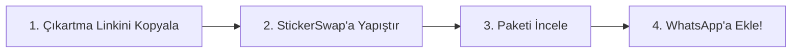
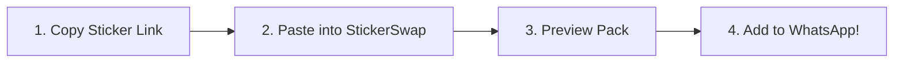

# StickerSwap 🔄

  

  <b>Telegram çıkartmalarınızı tek dokunuşla WhatsApp'a aktarın!</b> 
  <b>Transfer your favorite Telegram stickers directly to WhatsApp with a single tap!</b>

  
  
  

  <a href="#-türkçe"><b>🇹🇷 Türkçe Başlangıç</b></a> •
  <a href="#-english"><b>🇬🇧 English Guide</b></a>

---

# 🇹🇷 Türkçe

**StickerSwap**, Telegram'da beğendiğiniz tüm çıkartma paketlerini (sabit resimler, hareketli ve videolu çıkartmalar) doğrudan ve zahmetsizce **WhatsApp** ve **WhatsApp Business**'a eklemenizi sağlayan hızlı, modern ve kullanımı son derece kolay bir uygulamadır.

---

### ✨ Neler Yapabilirsiniz?

* 🚀 **Tek Tıkla Aktarım:** Çıkartma paketini bulun, "WhatsApp'a Ekle" butonuna basın ve kullanmaya başlayın.
* 🎬 **Tüm Çıkartma Türleri:** Sabit görseller, hareketli animasyonlar (.tgs) ve video çıkartmaları (.webm) destekler.
* 🔗 **Kolay Paylaşım:** Telegram'da bir çıkartmayı "Paylaş" deyip doğrudan StickerSwap'ı seçebilir ya da bağlantıyı kopyalayıp yapıştırabilirsiniz.
* 🌟 **Popüler Paketler Keşfi:** Ana sayfadaki trend ve popüler çıkartma paketlerini hemen keşfedin.
* 🔒 **Tamamen Gizli ve Güvenli:** Verileriniz herhangi bir uzak sunucuya gitmez, tüm işlem telefonunuzda gerçekleşir.

---

### 🚀 Hızlı Başlangıç (Nasıl Kullanılır?)

Uygulamayı kullanmak sadece birkaç saniyenizi alır:

1. **Telegram'dan Çıkartmayı Seçin:** 
   * Telegram'da beğendiğiniz paketin linkini kopyalayın (örn: `https://t.me/addstickers/paket_adi`) **veya**
   * Çıkartma paketinde "Paylaş" diyerek doğrudan **StickerSwap** uygulamasını seçin.
2. **Paketi Yükleyin:** Uygulama linki otomatik olarak algılar ve paketi ekranınıza getirir.
3. **WhatsApp'a Ekleyin:** Ekranın altındaki yeşil **"WhatsApp'a Ekle"** butonuna dokunun.
4. **Keyfini Çıkarın:** WhatsApp'ı açın, çıkartmalar sekmesine gidin ve arkadaşlarınızla paylaşmaya başlayın! 🎉

---

### 🔑 Kendi Telegram Bot Token'ınızı Kullanma (İsteğe Bağlı)

Uygulama hazır olarak gelir. Ancak kendi botunuzu bağlayarak daha hızlı ve kesintisiz çıkartma çekmek isterseniz:

1. Telegram'da **[@BotFather](https://t.me/BotFather)** botunu açın.
2. `/newbot` yazın ve talimatları takip ederek botunuza bir isim verin.
3. Size verilen **API Token** kodunu kopyalayın.
4. StickerSwap içinde **Ayarlar > Bot Token** alanına yapıştırın ve kaydedin.

---

 

# 🇬🇧 English

**StickerSwap** is a fast, clean, and modern app that allows you to effortlessly transfer any Telegram sticker pack—static, animated, or video—directly into **WhatsApp** and **WhatsApp Business**.

---

### ✨ Features

* 🚀 **One-Tap Export:** Find your favorite pack, hit "Add to WhatsApp", and start chatting right away.
* 🎬 **Full Format Support:** Supports static images, vector animations (.tgs), and video stickers (.webm).
* 🔗 **Quick Share Integration:** Tap "Share" on any sticker pack inside Telegram and select StickerSwap, or simply paste the link.
* 🌟 **Explore Trending Packs:** Discover popular curated sticker packs right from the home screen.
* 🔒 **Privacy First:** Sticker processing happens entirely on your device—no third-party cloud servers involved.

---

### 🚀 Quick Start Guide (How to Use)

Transferring stickers takes just a few simple steps:

1. **Get the Telegram Link:**
   * Copy any Telegram sticker pack link (e.g. `https://t.me/addstickers/pack_name`), **or**
   * Tap "Share" on the sticker pack within Telegram and choose **StickerSwap**.
2. **Fetch the Pack:** The app automatically reads the link and loads the stickers for preview.
3. **Add to WhatsApp:** Tap the green **"Add to WhatsApp"** button at the bottom.
4. **Enjoy:** Open WhatsApp, head to your stickers section, and enjoy your new stickers! 🎉

---

### 🔑 Using Your Own Telegram Bot Token (Optional)

StickerSwap works out of the box. However, if you want full independence and faster download limits, you can connect your own free Telegram Bot:

1. Open **[@BotFather](https://t.me/BotFather)** in Telegram.
2. Send `/newbot` and follow the quick instructions to set up a bot.
3. Copy the **API Token** provided by BotFather.
4. Open StickerSwap, go to **Settings > Bot Token**, paste the token, and save.

---

  Made with ❤️ for sticker lovers.

