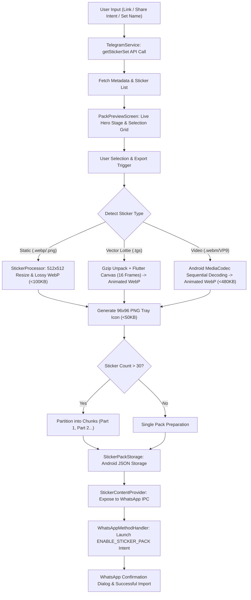
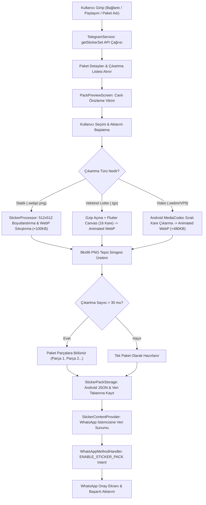

# StickerSwap 🔄

<p align="center">
  
</p>

<p align="center">
  <b>Export static, animated (.tgs), and video (.webm) Telegram stickers directly to WhatsApp with one click. Modern, privacy-focused, and corporate dual-theme Flutter application.</b>
</p>

<p align="center">
  <a href="#-features"></a>
  <a href="#-installation--setup"></a>
  <a href="#-installation--setup"></a>
  <a href="pubspec.yaml"></a>
  <a href="#-license"></a>
  <a href="#-testing"></a>
</p>

<p align="center">
  <b>Language / Dil:</b>
  <a href="#-english"><b>🇬🇧 English</b></a> •
  <a href="#-türkçe"><b>🇹🇷 Türkçe</b></a>
</p>

---

# 🇬🇧 English

## 📖 Table of Contents

- [Overview & Purpose](#-overview--purpose)
- [Key Features](#-key-features)
- [Architecture & Workflow](#-architecture--workflow)
  - [Processing Pipeline Flowchart](#processing-pipeline-flowchart)
  - [Sticker Format Conversion Engine](#sticker-format-conversion-engine)
  - [WhatsApp Compliance Specifications](#whatsapp-compliance-specifications)
- [Critical Technical Solutions & Root Cause Analysis](#-critical-technical-solutions--root-cause-analysis)
- [Application Screens & User Experience](#-application-screens--user-experience)
- [Project Directory Structure](#-project-directory-structure)
- [Installation & Setup](#-installation--setup)
- [Telegram Bot Token Setup Guide](#-telegram-bot-token-setup-guide)
- [Android Permissions & Manifest Configuration](#-android-permissions--manifest-configuration)
- [Testing](#-testing)
- [Changelog](#-changelog)
- [Contributing](#-contributing)
- [License](#-license)

---

## 🌟 Overview & Purpose

Telegram boasts one of the richest and most diverse sticker ecosystems in the world. However, when users wish to utilize these stickers on WhatsApp or WhatsApp Business, they encounter incompatible formats, resolution restrictions, file-size ceilings, and fragile third-party tools.

**StickerSwap** bridges Telegram and WhatsApp entirely on-device, with zero cloud server reliance, full privacy preservation, and seamless single-click workflows.

The application automatically identifies static images, vector Lottie animations (`.tgs`), and VP9 video stickers (`.webm`). It renders, scales, downsamples, and packages them in compliance with official WhatsApp specifications, serving them directly to WhatsApp via an integrated native Android `ContentProvider`.

---

## 🚀 Key Features

### ⚡ Flexible & Instant Import
- **Direct Links & Set Names:** Fetch packs instantly using Telegram links (`https://t.me/addstickers/set_name`, `tg://addstickers?set=set_name`) or raw set identifiers.
- **Android Share Intent Integration:** Tap "Share" on any pack inside Telegram and launch StickerSwap directly as the target import handler.
- **Quick Clipboard Paste:** One-tap clipboard detection and import trigger.
- **Curated & Trending Showcase:** Browse pre-categorized popular sticker packs (Memes, Cute, Reactions, etc.) right from the home screen.

### 🤖 Telegram Bot API & Custom Token Support
- Direct, authenticated communication with the Telegram Bot API.
- Custom bot token configuration for full autonomy and higher rate limits.
- **Interactive 5-Step Bot Token Guide:** Embedded guide with direct `@BotFather` shortcuts and single-tap command copying.
- Real-time token validation and testing (`/getMe` health check).

### 🎬 Comprehensive Format Support & Live Hero Player
- **Static Stickers:** Seamless conversion of `.webp` and `.png` images onto a 512x512 transparent canvas (< 100 KB).
- **Vector Lottie Animations (`.tgs`):** Decompresses gzip streams and renders 16 frames onto a 512x512 transparent Flutter Canvas, generating silky-smooth Animated WebPs.
- **Video Stickers (`.webm` / VP9):** Uses Android native hardware-accelerated `MediaExtractor` + `MediaCodec` sequential decoding to extract genuine inter-frames and compile compliant Animated WebPs (< 480 KB).
- **Graceful Thumbnail Fallback:** Generates looping 2-frame Animated WebPs from cached thumbnails if a video container has malformed headers, preventing export crashes.

### 🧩 WhatsApp 30-Sticker Limit & Guided Multi-Part Export
- Automatically partitions packs exceeding WhatsApp's 30-sticker threshold into sequential parts (e.g., `Part 1`, `Part 2`...).
- **Interactive Multi-Part Sheet (`_MultiPartExportSheet`):** Pre-processes all chunks locally and guides the user through each export step without thread lockups, race conditions, or infinite loops.

### 🛡️ 100% WhatsApp Compliance
- Text sanitizer enforcing WhatsApp's strict `[\\w-.,'\\s]+` pattern (ASCII normalization, character removal, and consecutive dot `..` stripping).
- Automatic generation of compliant **96x96** PNG tray icons (< 50 KB).
- Target selection between standard **WhatsApp** and **WhatsApp Business** (`com.whatsapp.w4b`).

### 💾 Local Library ("My Packs")
- Local archive of downloaded and converted packs.
- Bi-directional ContentProvider synchronization when deleting packs, preventing orphan records.
- Instant single-tap re-export to WhatsApp.
- Local cache calculation and storage cleaner.

### 🎨 Clean & Corporate Dual Theme
- High-contrast, balanced **Slate** color palette (eliminating over-saturated neon glows in favor of clean corporate geometry).
- ☀️ **Light Theme:** Slate 50–200 canvas with corporate blue accents.
- 🌙 **Dark Theme:** Slate 900–950 surface with modern blue highlights.
- Instant, flicker-free switching via `ThemeController`.

---

## 🏗️ Architecture & Workflow

StickerSwap combines a reactive Flutter UI layer with native Android media decoders and an IPC `ContentProvider`.

### Processing Pipeline Flowchart



### Sticker Format Conversion Engine

| Telegram Format | Source Characteristics | StickerSwap Conversion Engine | WhatsApp Output |
| :--- | :--- | :--- | :--- |
| **Static WebP / PNG** | Standard raster graphic | Proportional fitting, 16px transparent padding, WebP compression | 512x512 WebP, < 100 KB |
| **Lottie (.tgs)** | Gzip-compressed JSON vector animation | Dart `gzip.decode` + `LottieComposition` + `LottieDrawable` multi-frame canvas rendering | 512x512 Anim. WebP, < 480 KB |
| **Video (.webm)** | VP9 codec, single keyframe at timestamp 0 | Android native `MediaExtractor` + `MediaCodec` sequential timeline decoding, I420/NV12 -> NV21 conversion, frame assembly | 512x512 Anim. WebP, < 480 KB |

### WhatsApp Compliance Specifications

- **Dimensions:** Exactly 512 x 512 pixels with transparent background.
- **Margin:** At least 16 pixels between content and canvas edge.
- **File Size:** < 100 KB for static stickers; < 500 KB for animated stickers (StickerSwap enforces a safe 480 KB threshold).
- **Pack Size:** Minimum 3 stickers, maximum 30 stickers per pack.
- **Tray Icon:** Exactly 96 x 96 pixels transparent PNG, < 50 KB.
- **Metadata Rules:** Pack identifiers and publisher names must strictly match ASCII `[\\w-.,'\\s]+`, $\le 128$ characters, and contain no consecutive dots (`..`).

---

## 🛠️ Critical Technical Solutions & Root Cause Analysis

StickerSwap resolves several complex platform-level and IPC issues identified in WhatsApp sticker integrations:

### 1. Fix for *"Sticker Pack File Does Not Exist"* on Pack Removal
- **Root Cause:** When queried for a deleted or non-existent pack, `StickerContentProvider.kt` threw an `IllegalArgumentException` instead of returning an empty Cursor. WhatsApp intercepted this exception during deletion verification and terminated with an error dialog. Additionally, metadata column names were missing required prefixes, and `openFile` / `delete` methods threw `UnsupportedOperationException`.
- **Solution:** 
  - Updated `StickerContentProvider.kt` to safely return an empty `MatrixCursor` (0 rows) on missing records.
  - Implemented `openFile` and `openAssetFile` providing exact byte lengths (`file.length()`) in `AssetFileDescriptor`.
  - Implemented `delete(...)` with bi-directional storage synchronization and `contentResolver.notifyChange`.
  - Added all 13 official metadata columns, including `whatsapp_will_not_cache_stickers`.
  - Switched to deterministic pack identifiers (`${packName}_part${idx}`) to prevent phantom orphan IDs.

### 2. Fix for Animated Stickers Appearing Static in WhatsApp
- **Root Cause:** 
  1. `StickerPackModels.kt` omitted the `is_animated_sticker` column from `STICKER_COLUMNS`. WhatsApp defaulted every sticker to static (0) when this column was missing.
  2. Telegram animated video stickers use single-keyframe VP9 WebM. Android's native `MediaMetadataRetriever.getScaledFrameAtTime(...)` failed to seek inter-frames, returning byte-identical frame 0 across all sample timestamps.
- **Solution:**
  - Added `is_animated_sticker` column dynamically populated based on pack animation state.
  - Implemented a sequential `MediaExtractor` + `MediaCodec` (VP9) decoder pipeline in `MainActivity.kt` that iterates through genuine frame buffers.
  - Implemented a dedicated multi-frame canvas rendering pipeline (`processLottieSticker`) for vector `.tgs` files.

### 3. Fix for Multi-Part Pack Export Infinite Loop & Freeze
- **Root Cause:** The legacy third-party `whatsapp_stickers_handler` package failed to invoke MethodChannel `result.success(...)` inside Android's `onActivityResult` upon `RESULT_OK` or `RESULT_CANCELED`, leaving Dart `await` futures pending indefinitely.
- **Solution:**
  - Removed the third-party dependency and built proprietary Kotlin integration classes (`WhatsAppMethodHandler`, `StickerPackStorage`, `StickerContentProvider`).
  - Introduced the user-guided `_MultiPartExportSheet` to handle chunks sequentially with resume and cancel support.

---

## 📱 Application Screens & User Experience

| Screen | Responsibilities & Capabilities |
| :--- | :--- |
| **Home (`HomeScreen`)** | URL and set name input, quick clipboard paste, recent search history, categorized curated packs, bot token health banner, and theme switcher. |
| **Pack Preview (`PackPreviewScreen`)** | Interactive live hero stage (plays selected animated sticker), full sticker grid, select/deselect all, emoji search filter, multi-part export sheet, and progress bar. |
| **My Packs (`MyPacksScreen`)** | Archive of exported sticker packs, search filter, disk cache calculation, instant re-export to WhatsApp, and safe bi-directional pack deletion. |
| **Settings (`SettingsScreen`)** | Theme selection (Light/Dark), Telegram Bot Token configuration, live token health tester, WhatsApp & WhatsApp Business detection, publisher customization, and cache cleaner. |
| **Bot Token Guide (`BotTokenGuideSheet`)** | 5-step modal guiding users through generating their own free bot token via `@BotFather` with direct links and command copy shortcuts. |

---

## 📁 Project Directory Structure

```text
stickerswap/
├── android/                               # Native Android configuration & Kotlin engine
│   ├── app/
│   │   ├── build.gradle.kts               # Android build configurations & SDK settings
│   │   └── src/main/
│   │       ├── AndroidManifest.xml        # Permissions, deep links & ContentProvider declaration
│   │       └── kotlin/com/example/stickerswap/
│   │           ├── MainActivity.kt        # Share intent, deep links & MediaCodec VP9 extractor
│   │           └── whatsapp/
│   │               ├── StickerContentProvider.kt  # Official WhatsApp ContentProvider
│   │               ├── StickerPackModels.kt       # Metadata models & cursor definitions
│   │               ├── StickerPackStorage.kt      # Native JSON storage & resilient ID normalization
│   │               └── WhatsAppMethodHandler.kt   # WhatsApp intent lifecycle & Activity result
├── assets/
│   └── icon/
│       └── logo.png                       # Application icon
├── lib/                                   # Flutter application source code
│   ├── main.dart                          # App entry point & theme listener
│   ├── models/                            # Data transfer objects
│   │   ├── curated_pack.dart              # Curated sticker pack definitions
│   │   ├── saved_pack.dart                # Local saved WhatsApp sticker pack model
│   │   ├── telegram_sticker.dart          # Single sticker data model (static/animated/video)
│   │   └── telegram_sticker_set.dart      # Telegram sticker set model
│   ├── screens/                           # Application screens
│   │   ├── home_screen.dart               # Home screen, link input & curated recommendations
│   │   ├── main_navigation_screen.dart    # Bottom navigation bar
│   │   ├── my_packs_screen.dart           # Local saved packs library
│   │   ├── pack_preview_screen.dart       # Preview stage, filtering & export engine
│   │   └── settings_screen.dart           # Settings, token verification & cache maintenance
│   ├── services/                          # Application services
│   │   ├── sticker_processor.dart         # WebP/PNG converter, Lottie renderer & frame extractor
│   │   ├── storage_service.dart           # SharedPreferences & local file manager
│   │   ├── telegram_service.dart          # Telegram Bot API client & downloader
│   │   └── whatsapp_service.dart          # WhatsApp MethodChannel bridge & text sanitizer
│   ├── theme/                             # Design system
│   │   ├── app_theme.dart                 # Light and Dark corporate Slate palettes
│   │   └── theme_controller.dart          # Dynamic reactive theme controller
│   └── widgets/                           # Reusable UI widgets
│       ├── animated_sticker_player.dart   # Live Lottie/Video sticker preview player
│       ├── bot_token_guide_sheet.dart     # Step-by-step interactive Bot Token guide
│       ├── glass_card.dart                # Clean corporate card container
│       ├── gradient_button.dart           # Corporate button component
│       └── status_badge.dart              # Status chips (Video, Animated, etc.)
├── notlar.md                              # Developer notes & historical bug logs
├── pubspec.yaml                           # Dependencies, versioning (1.0.4+5) & assets
└── test/                                  # Unit tests
    ├── animated_webp_test.dart            # Multi-frame Animated WebP assembly test
    └── whatsapp_service_test.dart         # 30-item pack partitioning tests
```

---

## 💻 Installation & Setup

### Prerequisites
- **Flutter SDK:** ^3.11.4 or higher
- **Dart SDK:** ^3.11.4
- **Java Development Kit (JDK):** 17
- **Android SDK:** Min SDK 24 (Android 7.0+)
- **Device/Emulator:** Android physical device or emulator with WhatsApp or WhatsApp Business installed

### Step-by-Step Instructions

1. **Clone the repository:**
   ```bash
   git clone https://github.com/your_username/stickerswap.git
   cd stickerswap
   ```

2. **Install dependencies:**
   ```bash
   flutter pub get
   ```

3. **Run on connected device:**
   ```bash
   flutter run
   ```

4. **Build release APK:**
   ```bash
   flutter build apk --release
   ```
   *The release binary will be generated at `build/app/outputs/flutter-apk/app-release.apk`.*

---

## 🤖 Telegram Bot Token Setup Guide

StickerSwap fetches sticker binary streams directly from Telegram via the Bot API. Acquiring a bot token is **100% free** and takes under a minute:

1. Open Telegram and search for `@BotFather` (verified official bot).
2. Start the conversation and send `/newbot`.
3. Choose a display name (e.g. `MyStickerBot`).
4. Choose a unique username ending in `bot` (e.g. `my_stickerswap_bot`).
5. Copy the generated HTTP API Token:
   `123456789:ABCdefGHIjklMNOpqrsTUVwxyz`
6. Open StickerSwap, navigate to **Settings**, paste your token, and tap **"Verify Token"**.

---

## 🔒 Android Permissions & Manifest Configuration

- `android.permission.INTERNET`: Required to communicate with Telegram Bot API and download sticker binaries.
- `queries`: Configured in accordance with Android 11+ (API 30+) package visibility requirements to detect WhatsApp (`com.whatsapp`), WhatsApp Business (`com.whatsapp.w4b`), and Telegram clients.
- `ContentProvider`: Exposes `${applicationId}.stickercontentprovider` with `com.whatsapp.sticker.READ` permission for WhatsApp IPC access.
- `aaptOptions { noCompress("webp", "png") }`: Ensures sticker binaries are served uncompressed with exact byte descriptors.

---

## 🧪 Testing

Execute the test suite using Flutter's test runner:

```bash
flutter test
```

- **`test/whatsapp_service_test.dart`:** Validates 30-item pack partitioning logic, boundary conditions, and edge cases.
- **`test/animated_webp_test.dart`:** Verifies multi-frame Animated WebP encoding, frame timings, and 500 KB limit compliance.

---

## 📋 Changelog

### v1.0.4+5 (Current)
- **WhatsApp Animated Sticker Integration:** Added `is_animated_sticker` column to `StickerContentProvider`.
- **Hardware-Accelerated VP9 Video Decoder:** Replaced non-seeking `MediaMetadataRetriever` with sequential `MediaExtractor` + `MediaCodec` pipeline, resolving static video stickers.
- **Lottie (.tgs) Pipeline:** Implemented gzip decompression and 16-frame canvas rendering to compliant Animated WebPs.
- **WhatsApp Deletion Fix:** Resolved *"Sticker pack file does not exist"* error when deleting packs from WhatsApp.
- **Multi-Part Freeze Resolution:** Replaced legacy third-party plugin with native Kotlin `WhatsAppMethodHandler` and user-guided export flow.
- **Clean Corporate Dual Theme:** Eliminated neon glows in favor of balanced, corporate Slate palettes.

---

## 🤝 Contributing

Contributions are welcomed! To propose enhancements or fixes:

1. Fork the project.
2. Create your feature branch (`git checkout -b feature/NewFeature`).
3. Commit your changes (`git commit -m 'feat: Add NewFeature'`).
4. Push to the branch (`git push origin feature/NewFeature`).
5. Open a Pull Request.

---

## 📄 License

Distributed under the **MIT License**. See `LICENSE` for more information.

---
---

# 🇹🇷 Türkçe

## 📖 İçindekiler

- [Giriş ve Proje Amacı](#-giriş-ve-proje-amacı)
- [Öne Çıkan Özellikler](#-öne-çıkan-özellikler)
- [Mimari ve Çalışma Prensibi](#-mimari-ve-çalışma-prensibi)
  - [Süreç Akış Şeması](#süreç-akış-şeması)
  - [Çıkartma Formatları & Dönüştürme Motoru](#çıkartma-formatları--dönüştürme-motoru)
  - [WhatsApp Uyumluluk Standartları](#whatsapp-uyumluluk-standartları)
- [Önemli Teknik Geliştirmeler & Kök Çözümler](#-önemli-teknik-geliştirmeler--kök-çözümler)
- [Uygulama Ekranları ve Deneyim](#-uygulama-ekranları-ve-deneyim)
- [Proje Dosya Yapısı](#-proje-dosya-yapısı)
- [Kurulum & Çalıştırma](#-kurulum--çalıştırma)
- [Telegram Bot Token Alma Rehberi](#-telegram-bot-token-alma-rehberi)
- [Android İzinleri & Manifest](#-android-izinleri--manifest)
- [Testler](#-testler)
- [Sürüm Geçmişi (Changelog)](#-sürüm-geçmişi-changelog)
- [Katkıda Bulunma](#-katkıda-bulunma)
- [Lisans](#-lisans)

---

## 🌟 Giriş ve Proje Amacı

Telegram, dünyanın en zengin çıkartma (sticker) ekosistemlerinden birine sahiptir. Ancak kullanıcılar bu çıkartmaları WhatsApp veya WhatsApp Business üzerinde kullanmak istediklerinde uyumsuz dosya formatları, çözünürlük kısıtlamaları, dosya boyutu limitleri ve karmaşık üçüncü taraf araçlarla karşılaşırlar.

**StickerSwap**, Telegram ve WhatsApp ekosistemleri arasındaki bu köprüyü tamamen cihaz üzerinde, harici hiçbir sunucuya ihtiyaç duymadan, gizlilik odaklı ve tek tık kolaylığında kurar.

Uygulama; statik görselleri, vektörel Lottie animasyonlarını (`.tgs`) ve VP9 video çıkartmalarını (`.webm`) otomatik olarak tespit eder; WhatsApp'ın resmi gereksinimlerine göre yeniden boyutlandırır, optimize eder ve yerel Android `ContentProvider` motoru ile WhatsApp kütüphanenize entegre eder.

---

## 🚀 Öne Çıkan Özellikler

### ⚡ Esnek ve Hızlı İçe Aktarma
- **Bağlantı & İsim ile Aktarım:** Telegram çıkartma bağlantılarını (`https://t.me/addstickers/paket_adi`, `tg://addstickers?set=paket_adi`) veya doğrudan paket adını yapıştırarak anında çıkartma setini getirme.
- **Doğrudan Paylaşım Menüsü (Share Intent):** Telegram içerisindeyken herhangi bir pakette "Paylaş" seçildiğinde StickerSwap'ın otomatik olarak hedef uygulama olarak açılması.
- **Pano Entegrasyonu:** Kopyalanan bağlantıyı tek tıkla yapıştırma butonu.
- **Popüler ve Önerilen Paketler:** Ana sayfada kategorilere ayrılmış popüler çıkartma paketleri (Memeler, Sevimli, Tepkiler, vb.) ile anında keşfetme.

### 🤖 Telegram Bot API & Kişisel Bot Token Desteği
- Telegram Bot API üzerinden doğrudan ve güvenli iletişim.
- Kullanıcıların kendi bot token'larını tanımlayabilmesi.
- Dahili **5 Adımlı İnteraktif Bot Token Rehberi** (`@BotFather` doğrudan bağlantısı ve tek dokunuşla komut kopyalama).
- Canlı token test ve doğrulama motoru (`/getMe` kontrolü).

### 🎬 Eksiksiz Çıkartma Formatı Desteği
- **Statik Çıkartmalar:** `.webp` ve `.png` formatlarını otomatik 512x512 piksel şeffaf kanvasa yerleştirme (< 100 KB).
- **Vektörel Lottie Çıkartmaları (`.tgs`):** Gzip sıkıştırmasını açıp Flutter Canvas üzerinde 16 karelik şeffaf sekans olarak çizdirerek akıcı Animated WebP oluşturma.
- **Video Çıkartmaları (`.webm` / VP9):** Android'in donanım hızlandırmalı `MediaExtractor` ve `MediaCodec` motorlarıyla ardışık kare çıkarma ve optimize Animated WebP'ye derleme (< 480 KB).
- **Akıllı Küçük Resim (Thumbnail) Fallback:** Başlığı bozuk veya hasarlı dosyalarda aktarımın çökmesini önleyen 2 kareli döngüsel WebP kurtarma mekanizması.

### 🧩 WhatsApp 30 Sınırı & Akıllı Çok Parçalı (Multi-Part) Aktarım
- WhatsApp'ın resmi pakette 3-30 çıkartma kuralı doğrultusunda, 30'dan fazla çıkartma içeren paketleri otomatik olarak `Parça 1`, `Parça 2`... şeklinde bölme.
- **Kullanıcı Kontrollü Aktarım Sayfası (`_MultiPartExportSheet`):** Arka planda donma ve kilitlenme olmaksızın, kullanıcı WhatsApp onay ekranından her döndüğünde ilgili parçayı yeşil tik ile onaylama ve sonraki parçayı adım adım sunma.

### 🛡️ Resmi WhatsApp Standartlarına Tam Uyum
- WhatsApp StickerPackValidator kurallarına tam uyumlu metin temizleme motoru (ASCII harf/rakam kontrolü, çift nokta `..` ve yasaklı karakter temizliği).
- Otomatik **96x96 piksel** PNG tepsi (tray) simgesi üretimi (< 50 KB).
- WhatsApp ve WhatsApp Business (`com.whatsapp.w4b`) hedef seçimi.

### 💾 Yerel Paket Kütüphanesi ("Paketlerim")
- İndirilen ve derlenen paketlerin yerel depolamada saklanması.
- WhatsApp'tan silinen veya cihazda kalan paketleri yerel Android ContentProvider ile senkronize silme.
- Tek dokunuşla WhatsApp'a yeniden gönderebilme.
- Önbellek boyutu hesaplama ve tek tıkla temizleme.

### 🎨 Sade, Dengeli ve Kurumsal Çift Tema
- Göz yormayan kurumsal **Slate** renk paleti (Neon veya aşırı parlak blurlar yerine düz, modern ve yüksek kontrastlı arayüz).
- ☀️ **Açık Tema:** Slate 50-200 zemin, koyu tipografi ve kurumsal mavi vurgular.
- 🌙 **Koyu Tema:** Slate 900-950 zemin, berrak açık tipografi ve modern mavi butonlar.
- `ThemeController` ile anında tema geçişi.

---

## 🏗️ Mimari ve Çalışma Prensibi

StickerSwap, modern Flutter UI katmanı ile Android'in yerel medya kod çözücülerini ve ContentProvider mimarisini birleştiren hibrit bir yapıya sahiptir.

### Süreç Akış Şeması



### Çıkartma Formatları & Dönüştürme Motoru

| Telegram Formatı | Format Açıklaması | StickerSwap Dönüştürme Yöntemi | WhatsApp Çıktısı |
| :--- | :--- | :--- | :--- |
| **Statik WebP / PNG** | Hareketsiz çıkartmalar | Orantılı ölçekleme, 16px şeffaf kenar payı, kayıplı WebP sıkıştırması | 512x512 WebP, < 100 KB |
| **Lottie (.tgs)** | Gzip ile sıkıştırılmış JSON vektörel animasyon | Dart `gzip.decode` + `LottieComposition` + `LottieDrawable` ile 16 karelik 512x512 Canvas çizimi ve animasyonlu WebP derleme | 512x512 Anim. WebP, < 480 KB |
| **Video (.webm)** | VP9 kodek tek anahtar kareli (keyframe-0) WebM videoları | Android yerel `MediaExtractor` + `MediaCodec` sıralı zaman çizelgesi ayrıştırma, I420/NV12 -> NV21 dönüşümü ve çoklu kareli animasyonlu WebP derleme | 512x512 Anim. WebP, < 480 KB |

### WhatsApp Uyumluluk Standartları

- **Çözünürlük:** Tam olarak 512 x 512 piksel (şeffaf zemin).
- **Kenar Payı:** Çıkartma ile görsel kenarları arasında en az 16 piksel boşluk.
- **Dosya Boyutu:** Statik çıkartmalarda < 100 KB; hareketli çıkartmalarda < 500 KB (StickerSwap 480 KB emniyet eşiğini kullanır).
- **Paket Kapasitesi:** En az 3, en fazla 30 çıkartma.
- **Tepsi (Tray) Simgesi:** 96 x 96 piksel şeffaf PNG formatında, < 50 KB.
- **Karakter Kuralları:** Yayıncı adı ve paket tanımlayıcılarında ASCII uyumlu `[\\w-.,'\\s]+` deseni, maksimum 128 karakter, çift nokta (`..`) içermez.

---

## 🛠️ Önemli Teknik Geliştirmeler & Kök Çözümler

### 1. WhatsApp'tan Paket Silerken *"Paket Dosyası Mevcut Değil"* Hatası Çözümü
- **Kök Neden:** `StickerContentProvider.kt` içerisinde paket sorgulandığında veri tabanında bulunamazsa boş bir Cursor dönmek yerine `IllegalArgumentException` fırlatılıyordu. WhatsApp silme işlemi öncesinde paketi doğrulamak isterken bu hatayı alıp işlemi durduruyordu. Ayrıca resmi WhatsApp ContentProvider metadata kolonlarındaki ön ekler eksikti ve `openFile` ile `delete` metotları desteklenmiyordu.
- **Çözüm:** 
  - Bulunamayan sorgularda istisna fırlatmak yerine güvenli 0 satırlı `MatrixCursor` dönüldü.
  - `openFile` ve `openAssetFile` metotlarına dosyanın net bayt uzunluğu (`file.length()`) eklendi.
  - `delete(...)` metodu yerel depolama ve `contentResolver.notifyChange` ile senkronize edildi.
  - WhatsApp'ın beklediği 13 metadata kolonu ve `whatsapp_will_not_cache_stickers` alanı eksiksiz tanımlandı.
  - Paket kimlikleri deterministik hale getirildi (`${packName}_part${idx}`).

### 2. Hareketli Çıkartmaların WhatsApp'ta Statik Kalması Sorunu Çözümü
- **Kök Neden:** 
  1. ContentProvider kolonları arasında `is_animated_sticker` kolonu yer almıyordu; WhatsApp bu kolonu bulamadığında çıkartmaları statik (0) varsayıyordu.
  2. Telegram video çıkartmaları tek anahtar kareye (keyframe 0) sahip VP9 WebM formatındadır. Android'in standart `MediaMetadataRetriever.getScaledFrameAtTime(...)` fonksiyonu zaman damgalı arama (seek) yapamadığı için tüm karelerde video başındaki 0. kareyi dönüyor ve tüm karelerin özeti (MD5) aynı çıkıyordu.
- **Çözüm:**
  - `STICKER_COLUMNS` yapısına `is_animated_sticker` kolonu entegre edildi.
  - `MainActivity.kt` içerisine `MediaExtractor` + `MediaCodec` (VP9) donanım kod çözücü motoru yazılarak video zaman çizelgesindeki benzersiz gerçek kareler sıralı olarak ayrıştırıldı.
  - Vektörel animasyonlar için `.tgs` Lottie çizim boru hattı (`StickerProcessor.processLottieSticker`) geliştirildi.

### 3. Çok Parçalı Paketlerde Sonsuz Döngü ve Kilitlenme Çözümü
- **Kök Neden:** Eski üçüncü taraf `whatsapp_stickers_handler` kütüphanesinin Android `onActivityResult` olayında `RESULT_OK` veya `RESULT_CANCELED` dönüşlerinde MethodChannel yanıtı vermemesi Flutter tarafındaki `Future`'ın sonsuza kadar askıda kalmasına neden oluyordu.
- **Çözüm:**
  - Hatalı üçüncü taraf kütüphane projeden tamamen çıkarılarak projeye özel yerel Kotlin sınıfları (`WhatsAppMethodHandler`, `StickerPackStorage`, `StickerContentProvider`) yazıldı.
  - Kullanıcı kontrollü `_MultiPartExportSheet` arayüzü ile kullanıcı her parçayı WhatsApp'ta onaylayıp döndükçe sonraki parça güvenle sıraya alındı.

---

## 📱 Uygulama Ekranları ve Deneyim

| Ekran | Görev ve Yetenekler |
| :--- | :--- |
| **Ana Sayfa (`HomeScreen`)** | Bağlantı veya paket adı arama alanı, panodan yapıştırma, son aranan paketler geçmişi, kategorize popüler paketler listesi, Bot Token uyarı kartı ve tema değiştirici. |
| **Paket İnceleme (`PackPreviewScreen`)** | Canlı vitrin (seçilen animasyonlu çıkartmanın hareketli önizlemesi), tüm çıkartmaların grid görünümü, tek tıkla tümünü seçme/kaldırma, emojiye göre arama/filtreleme, çok parçalı aktarım modalı ve aktarım ilerleme çubuğu. |
| **Paketlerim (`MyPacksScreen`)** | Daha önce cihaza indirilip aktarılan paketlerin listesi, paket arama, depolama/önbellek boyutu göstergesi, paketi tek tıkla WhatsApp'a tekrar gönderme veya cihazdan/ContentProvider'dan tamamen silme. |
| **Ayarlar (`SettingsScreen`)** | Koyu / Açık tema seçimi, Telegram Bot Token yönetimi, canlı token doğrulama testi, WhatsApp ve WhatsApp Business algılama durumu, varsayılan yayıncı adı tanımlama, önbellek temizleyici. |
| **Bot Token Rehberi (`BotTokenGuideSheet`)** | Kullanıcının kendi botunu oluşturup token almasını sağlayan 5 adımlı görsel ve interaktif rehber (@BotFather doğrudan bağlantısı, `/newbot` komutunu tek tıkla kopyalama). |

---

## 📁 Proje Dosya Yapısı

```text
stickerswap/
├── android/                               # Yerel Android yapılandırması & Kotlin motoru
│   ├── app/
│   │   ├── build.gradle.kts               # Android derleme ayarları, SDK seviyeleri & aaptOptions
│   │   └── src/main/
│   │       ├── AndroidManifest.xml        # İzinler, derin bağlantılar & ContentProvider bildirimi
│   │       └── kotlin/com/example/stickerswap/
│   │           ├── MainActivity.kt        # Share intent, derin bağlantılar & MediaCodec VP9 çıkarıcı
│   │           └── whatsapp/
│   │               ├── StickerContentProvider.kt  # WhatsApp resmi ContentProvider uygulaması
│   │               ├── StickerPackModels.kt       # WhatsApp spesifikasyon kolonları & modelleri
│   │               ├── StickerPackStorage.kt      # Yerel paket saklama ve ID normalizasyonu
│   │               └── WhatsAppMethodHandler.kt   # WhatsApp intent yönetimi ve Activity sonucu
├── assets/
│   └── icon/
│       └── logo.png                       # Uygulama logosu ve marka görseli
├── lib/                                   # Flutter uygulama kaynak kodları
│   ├── main.dart                          # Başlangıç noktası & tema dinleyicisi
│   ├── models/                            # Veri modelleri
│   │   ├── curated_pack.dart              # Önerilen & popüler paket tanımları
│   │   ├── saved_pack.dart                # Yerel kaydedilen WhatsApp paketi modeli
│   │   ├── telegram_sticker.dart          # Tekil çıkartma modeli (statik/animasyonlu/video)
│   │   └── telegram_sticker_set.dart      # Telegram çıkartma seti modeli
│   ├── screens/                           # Uygulama ekranları
│   │   ├── home_screen.dart               # Ana sayfa, bağlantı girişi & popüler paketler
│   │   ├── main_navigation_screen.dart    # Alt gezinme çubuğu (Bottom Navigation)
│   │   ├── my_packs_screen.dart           # Kaydedilen paketler kütüphanesi
│   │   ├── pack_preview_screen.dart       # Önizleme vitrini, filtreleme & aktarım motoru
│   │   └── settings_screen.dart           # Ayarlar, token testi & önbellek yönetimi
│   ├── services/                          # Arka plan ve iletişim servisleri
│   │   ├── sticker_processor.dart         # WebP/PNG derleme, Lottie çizimi & video kare çıkarma
│   │   ├── storage_service.dart           # SharedPreferences & yerel dosya yönetimi
│   │   ├── telegram_service.dart          # Telegram Bot API istemcisi & dosya indirme
│   │   └── whatsapp_service.dart          # WhatsApp MethodChannel köprüsü & metin temizleme
│   ├── theme/                             # Tasarım sistemi
│   │   ├── app_theme.dart                 # Açık ve Koyu kurumsal Slate renk paletleri
│   │   └── theme_controller.dart          # Reaktif tema yönetim kontrolcüsü
│   └── widgets/                           # Yeniden kullanılabilir arayüz bileşenleri
│       ├── animated_sticker_player.dart   # Lottie & Video canlı çıkartma oynatıcı
│       ├── bot_token_guide_sheet.dart     # Adım adım Bot Token rehberi modalı
│       ├── glass_card.dart                # Sade kurumsal kart konteyneri
│       ├── gradient_button.dart           # Kurumsal degrade buton bileşeni
│       └── status_badge.dart              # Çıkartma türü etiketleri (Video, Hareketli vb.)
├── notlar.md                              # Detaylı geliştirici notları & test günlükleri
├── pubspec.yaml                           # Bağımlılıklar, sürüm bilgisi (1.0.4+5) ve varlıklar
└── test/                                  # Birim testleri
    ├── animated_webp_test.dart            # Animasyonlu WebP derleme ve boyut testi
    └── whatsapp_service_test.dart         # 30'lu paket bölme (chunking) mantık testleri
```

---

## 💻 Kurulum & Çalıştırma

### Ön Gereksinimler
- **Flutter SDK:** ^3.11.4 veya üzeri
- **Dart SDK:** ^3.11.4
- **Java Development Kit (JDK):** 17
- **Android Studio** / VS Code & Android SDK (Min SDK: 24, Android 7.0+)
- **Fiziksel Cihaz veya Emülatör:** WhatsApp veya WhatsApp Business yüklü Android cihaz

### Adım Adım Kurulum

1. **Depoyu Klonlayın:**
   ```bash
   git clone https://github.com/kullanici_adiniz/stickerswap.git
   cd stickerswap
   ```

2. **Bağımlılıkları Yükleyin:**
   ```bash
   flutter pub get
   ```

3. **Cihazınızı Bağlayın ve Uygulamayı Başlatın:**
   ```bash
   flutter run
   ```

4. **Release APK Üretimi:**
   ```bash
   flutter build apk --release
   ```
   *Üretilen APK dosyası `build/app/outputs/flutter-apk/app-release.apk` dizininde yer alacaktır.*

---

## 🤖 Telegram Bot Token Alma Rehberi

StickerSwap, Telegram Bot API üzerinden çıkartma verilerini doğrudan Telegram sunucularından çeker. Kendi bot token'ınızı almak **tamamen ücretsizdir** ve yalnızca 1 dakikanızı alır:

1. Telegram'ı açın ve arama çubuğuna `@BotFather` yazın (mavi onay rozetli resmi bot).
2. Sohbeti başlatıp `/newbot` komutunu gönderin.
3. Botunuz için bir isim belirleyin (Örn: `BenimStickerBotum`).
4. `bot` ile biten benzersiz bir kullanıcı adı seçin (Örn: `benim_stickerswap_bot`).
5. BotFather size şu formatta bir HTTP API Token verecektir:
   `123456789:ABCdefGHIjklMNOpqrsTUVwxyz`
6. StickerSwap uygulamasında **Ayarlar** sekmesine gidin, token'ı yapıştırın ve **"Token'ı Doğrula"** butonuna dokunun.

> [!TIP]
> Uygulama içerisindeki **"Nasıl Bot Token Alınır?"** butonuna basarak doğrudan `@BotFather` bağlantısına gidebilir ve komutları tek dokunuşla kopyalayabilirsiniz.

---

## 🔒 Android İzinleri & Manifest

- `android.permission.INTERNET`: Telegram Bot API ile iletişim kurmak ve çıkartma dosyalarını indirmek için gereklidir.
- `queries`: Android 11+ (API 30+) Paket Görünürlüğü kuralları doğrultusunda WhatsApp (`com.whatsapp`), WhatsApp Business (`com.whatsapp.w4b`) ve Telegram istemcilerini sorgulayabilmek için tanımlanmıştır.
- `ContentProvider`: WhatsApp'ın çıkartma dosyalarını StickerSwap yerel depolama alanından güvenle okuyabilmesi için `${applicationId}.stickercontentprovider` yetkilisi `com.whatsapp.sticker.READ` izniyle dışa açılmıştır.
- `aaptOptions { noCompress("webp", "png") }`: WhatsApp ContentProvider dosya tanımlayıcılarının (AssetFileDescriptor) sıkıştırmasız ve tam bayt uzunluğuyla doğrudan aktarılmasını sağlar.

---

## 🧪 Testler

```bash
flutter test
```

- **`test/whatsapp_service_test.dart`:** Paketlerin 30'lu parçalara ayrılması (`splitIntoPacks`), sınır koşulları (tam 30, 30'dan az, 75 eleman) doğrulaması.
- **`test/animated_webp_test.dart`:** Çok kareli animasyonlu WebP derleme, kare süreleri ve 500 KB limit kontrolü.

---

## 📋 Sürüm Geçmişi (Changelog)

### v1.0.4+5 (Güncel)
- **WhatsApp Animated Sticker Desteği:** `StickerContentProvider`'a `is_animated_sticker` kolonu eklendi.
- **Donanım Destekli VP9 Video Çözücü:** `MediaMetadataRetriever` yerine `MediaExtractor` + `MediaCodec` sıralı zaman çizelgesi çıkarıcı geliştirildi; video çıkartmalarının statik kalması kökten çözüldü.
- **Lottie (.tgs) Dönüştürme:** Gzip açma ve 16 karelik Canvas çizimi ile tam uyumlu animasyonlu WebP derleyici eklendi.
- **WhatsApp Silme Hatası Düzeltmesi:** WhatsApp "Çıkartmalarım" menüsünden paket kaldırılırken oluşan *"Paket dosyası mevcut değil"* hatası giderildi (boş MatrixCursor, `openFile` ve `delete` desteği).
- **Çok Parçalı Kilitlenme Çözümü:** 30'dan fazla çıkartma içeren setlerde `_MultiPartExportSheet` ile kullanıcı rehberli, adım adım ve donmasız aktarım akışı sağlandı.
- **Kurumsal & Sade Tasarım:** Neon blurlar ve parlamalar kaldırılarak göz yormayan, dengeli ve kurumsal Slate renk paletine (Açık ve Koyu tema) geçildi.

---

## 🤝 Katkıda Bulunma

1. Projeyi Fork'layın (`Fork`).
2. Yeni bir özellik dalı (branch) oluşturun (`git checkout -b feature/YeniOzellik`).
3. Değişikliklerinizi commit edin (`git commit -m 'feat: Yeni özellik eklendi'`).
4. Dalınıza push yapın (`git push origin feature/YeniOzellik`).
5. Bir **Pull Request** açın.

---

## 📄 Lisans

Bu proje **MIT Lisansı** altında lisanslanmıştır. Detaylı bilgi için proje kök dizinindeki lisans koşullarını inceleyebilirsiniz.

<p align="center">
  Geliştirici & Tasarımcı sevgisiyle üretilmiştir. 🚀
</p>
