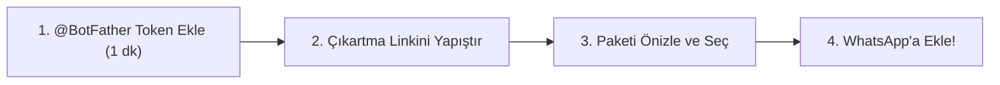
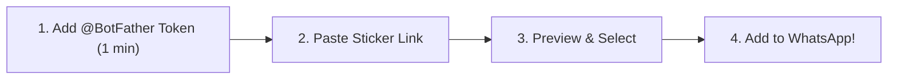

# StickerSwap 🔄

  

  <b>Telegram çıkartmalarınızı tek dokunuşla WhatsApp'a aktarın!</b> 
  <b>Transfer your favorite Telegram stickers directly to WhatsApp with a single tap!</b>

  
  
  

  <a href="#-türkçe"><b>🇹🇷 Türkçe Başlangıç</b></a> •
  <a href="#-english"><b>🇬🇧 English Guide</b></a>

---

# 🇹🇷 Türkçe

**StickerSwap**, Telegram'da beğendiğiniz çıkartma paketlerini (statik görseller, hareketli `.tgs` ve videolu `.webm` çıkartmalar) doğrudan cihazınızda işleyerek **WhatsApp** ve **WhatsApp Business**'a aktarmanızı sağlayan açık kaynaklı, reklamsız ve gizlilik odaklı bir uygulamadır.

---

### ✨ Neler Yapabilirsiniz?

* 🚀 **Tek Tıkla Aktarım:** Çıkartma paketini getirin, istediğiniz çıkartmaları seçin ve **"WhatsApp'a Ekle"** butonuna dokunun.
* 🎬 **Tüm Çıkartma Türleri:** Sabit görseller, hareketli Lottie animasyonları (`.tgs`) ve video çıkartmalarını (`.webm`) WhatsApp uyumlu WebP formatına dönüştürür.
* 🔗 **Kolay Paylaşım:** Telegram'da bir paketi "Paylaş" deyip doğrudan **StickerSwap**'ı seçebilir veya bağlantıyı yapıştırabilirsiniz.
* ✏️ **Özelleştirme ve Kayıtlı Paketler:** Aktarım öncesi paket/yayıncı adını düzenleyin, 30'dan büyük paketleri otomatik bölün ve son aramalarınıza hızlıca erişin.
* 🔒 **Tamamen Gizli ve Güvenli:** Merkezi bir ara sunucu kullanılmaz. Tüm indirme ve dönüştürme işlemleri telefonunuzda yapılır; Bot Token'ınız cihazın güvenli deposunda (Android Keystore) şifrelenerek saklanır.

---

### 📱 Platform Desteği

| Platform | Durum | Açıklama |
| :--- | :---: | :--- |
| **Android** | ✅ **Tam Destek** | WhatsApp & WhatsApp Business doğrudan çıkartma paketi aktarımı tam olarak desteklenir. |
| **iOS** | ⛔ **Desteklenmiyor** | StickerSwap yalnızca **Android** odaklı geliştirilmektedir; iOS için aktif geliştirme veya destek planlanmamaktadır. |

---

### 🔑 Telegram Bot Token Neden Gerekli ve Nasıl Alınır? (~1 Dakika)

Telegram, çıkartma paketlerinin yüksek çözünürlüklü dosyalarını yalnızca resmi **Telegram Bot API** üzerinden sunar. StickerSwap ise aradaki üçüncü parti sunuculara veri/trafik göndermeyen, **tamamen cihaz içi (sunucusuz)** bir araçtır. Bu nedenle ilk kurulumda kendi ücretsiz Telegram Bot Token'ınızı eklemeniz gerekir:

1. Telegram'da **[@BotFather](https://t.me/BotFather)** sohbetini açın.
2. `/newbot` komutunu gönderin ve botunuz için bir ad ile `...bot` ile biten bir kullanıcı adı belirleyin.
3. BotFather'ın verdiği **HTTP API Token** değerini kopyalayın.
4. StickerSwap uygulamasını açın; ana ekrandaki **"İlk Kurulum / Token Ekle"** yönlendirmesinden veya **Ayarlar > Telegram Bot Token** bölümünden token'ı yapıştırıp doğrulayın.

> Token yalnızca Telegram API ile doğrudan cihazınız arasında kullanılır ve cihazın güvenli deposunda şifreli olarak saklanır.

---

### 🚀 Hızlı Başlangıç (Nasıl Kullanılır?)

1. **İlk Kurulum:** Yukarıdaki adımlarla kendi ücretsiz Bot Token'ınızı uygulamaya ekleyin.
2. **Telegram'dan Çıkartmayı Seçin:** Beğendiğiniz paketin linkini (`https://t.me/addstickers/paket_adi`) kopyalayıp yapıştırın ya da Telegram'dan **Paylaş > StickerSwap** deyin.
3. **Paketi İnceleyin:** Çıkartmaları seçin, isterseniz paket/yayıncı adını özelleştirin.
4. **WhatsApp'a Ekleyin:** **"WhatsApp'a Ekle"** butonuna dokunun ve WhatsApp çıkartmalar sekmesinde kullanmaya başlayın! 🎉

---

 

# 🇬🇧 English

**StickerSwap** is an open-source, privacy-first app that converts Telegram sticker packs—static images, animated `.tgs`, and video `.webm` stickers—entirely on your device and exports them to **WhatsApp** and **WhatsApp Business**.

---

### ✨ Features

* 🚀 **One-Tap Export:** Fetch any Telegram pack, pick your stickers, and tap **"Add to WhatsApp"**.
* 🎬 **Full Format Support:** Converts static stickers, vector animations (`.tgs`), and video stickers (`.webm`) into WhatsApp-compliant WebP packs.
* 🔗 **Quick Share Integration:** Tap "Share" on any sticker pack inside Telegram and choose **StickerSwap**, or paste the link directly.
* ✏️ **Customization & Saved Packs:** Edit pack/publisher names before export, auto-split packs larger than 30 stickers, and revisit recent searches.
* 🔒 **Privacy First:** No third-party backend or proxy server is used. All processing runs locally on your phone, and your Bot Token is encrypted in native secure storage (Android Keystore).

---

### 📱 Platform Support

| Platform | Status | Notes |
| :--- | :---: | :--- |
| **Android** | ✅ **Full Support** | Direct export to WhatsApp & WhatsApp Business is fully supported. |
| **iOS** | ⛔ **Not Supported** | StickerSwap is developed exclusively for **Android**; iOS support is not actively developed or planned. |

---

### 🔑 Why a Telegram Bot Token Is Required & How to Get One (~1 Minute)

Telegram only exposes downloadable sticker pack files through the official **Telegram Bot API**. Because StickerSwap runs **100% on-device with no central proxy server**, you connect your own free bot token during initial setup:

1. Open **[@BotFather](https://t.me/BotFather)** in Telegram.
2. Send `/newbot` and follow the short prompts to choose a display name and a username ending in `bot`.
3. Copy the **HTTP API Token** provided by BotFather.
4. Open StickerSwap and paste it via the **"Initial Setup / Add Token"** prompt on the home screen or under **Settings > Telegram Bot Token**.

> Your token is stored encrypted on your device and is only sent directly to `api.telegram.org`.

---

### 🚀 Quick Start Guide

1. **Initial Setup:** Add your free Telegram Bot Token once.
2. **Get the Telegram Link:** Paste a pack link (`https://t.me/addstickers/pack_name`) or use **Share > StickerSwap** directly from Telegram.
3. **Preview & Customize:** Select stickers and optionally customize the pack or publisher name.
4. **Add to WhatsApp:** Tap **"Add to WhatsApp"** and enjoy your stickers! 🎉

---

  Made with ❤️ for sticker lovers.

