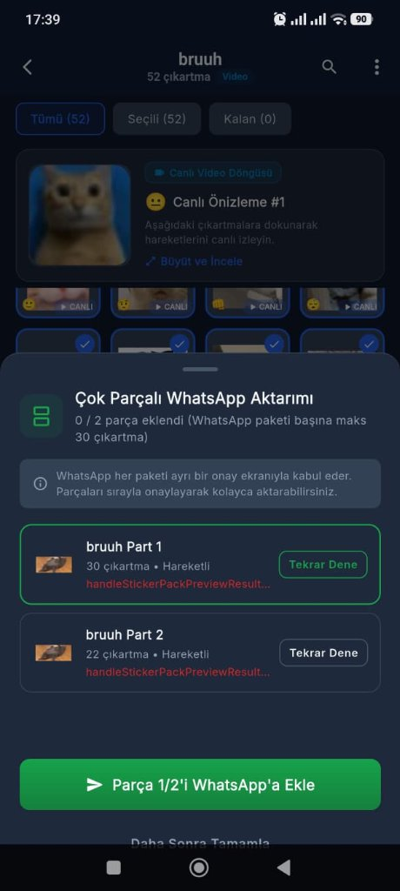
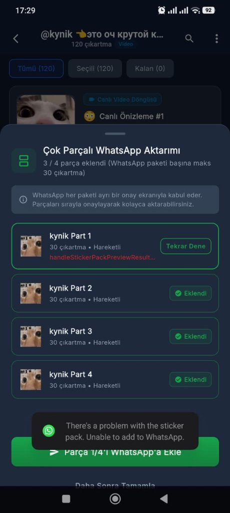

# StickerSwap - Geliştirici Notları & Yol Haritası (Developer Notes & Roadmap)

> [!IMPORTANT]
> **📌 Asla Değişmeyecek Madde (Sürümleme Kuralı):**
> Her yeni sürümde `pubspec.yaml` dosyasındaki `version` sürüm numarası mutlaka bir artırılmalıdır (ör. `1.0.3` → `1.0.4`, `1.0.5` → `1.0.6`).

---

## 🇹🇷 Türkçe (Turkish)

### 1. Çıkartmalar İlk Kez İndirilip Hazırlanırken Uygulamanın Donması / Yanıt Vermemesi (Optimizasyon İhtiyacı)
- **Öncelik:** 🔴 **YÜKSEK (1. Öncelik)**
- **Durum:** ✅ **TAMAMLANDI & TEST EDİLDİ**
- **Sorun Tanımı:**
  - Donma ve kilitlenme sorunu WhatsApp ekranı açıldığında değil; **kullanıcı paket linkini verip çıkartmaları seçtikten sonra *"WhatsApp'a Aktar"* işlemini ilk başlattığı anda** gerçekleşmektedir.
  - Uygulama bu aşamada çok parçalı veya tekil tüm çıkartmaları (özellikle 30, 50, 120 adet veya hareketli/video WebM) Telegram sunucularından **tek tek çekmeye, karelerini ayrıştırmaya ve dönüştürmeye başladığında** arayüz tamamen donmakta, dokunmatik yanıtsız kalmakta, ilerleme göstergesi takılmakta ve cihazda "Uygulama Yanıt Vermiyor" (ANR) uyarısı oluşma riski doğmaktadır.
- **Tespit Edilen Kök Nedenler:**
  1. **Ana UI Isolate Üzerinde Yoğun CPU Tüketimi (Main Thread Blocking):**
     - Çıkartmaların indirilip yerel olarak hazırlandığı bu ön hazırlık evresinde `StickerProcessor` sınıfındaki görsel işleme operasyonları (`img.decodeImage`, `_fitImage`, `img.compositeImage`, `img.encodeWebP`) Flutter'ın ana UI iş parçacığında (main isolate) senkron çalıştırılmaktadır.
     - Her video çıkartma için Android `MediaCodec` motorundan 18 ham kare çekilmekte; bu 18 karenin her biri ana isolate'te tek tek decode edilip 512x512 canvas'a çizilmekte ve `package:image` saf Dart motoruyla çok katmanlı döngüde (kalite %75, %60, %45, %30) tekrar tekrar WebP olarak sıkıştırılmaktadır.
     - Tek bir video çıkartmanın kodlanması CPU'da 1-3 saniye sürdüğünden, 30 ila 120 çıkartmanın tek tek çekilip işlenmesi ana iş parçacığını dakikalarca kilitli tutmaktadır.
  2. **Seri İndirme ve İşleme Sıralaması (Sequential Pipeline Bottleneck):**
     - Telegram'dan ağ üzerinden tek tek indirme (`downloadSticker`) ile CPU tabanlı görüntü kodlama adımları art arda (sequential) tek bir döngüde çalıştırılmaktadır. Ağ beklemesi ile CPU iş yükünün birbirini bloklaması arayüzün askıda kalma süresini aşırı uzatmaktadır.
  3. **Bellek Şişmesi ve Çöp Toplayıcı (GC) Baskısı:**
     - Onlarca çıkartma işlenirken açılan büyük çözünürlüklü `Image` nesneleri ve ham bayt dizileri RAM'de birikmekte, sistem sık sık Garbage Collection (GC) tetikleyerek arayüzün tamamen duraksamasına yol açmaktadır.

- **Tamamlanan Optimizasyonlar & Eylem Planı:**
  - [x] **Arka Plan Isolate (Worker Threads) Entegrasyonu:** Ağır görsel çözme, boyutlandırma ve WebP kodlama adımları `Isolate.run` ile arka plan worker iş parçacıklarına taşındı. Ana UI iş parçacığı serbest bırakılarak 60/120 FPS akıcılık korundu; isolate işi bitince RAM çöp toplayıcı yükü olmadan otomatik temizlendi.
  - [x] **Boru Hattı (Pipelined Concurrent Processing):** İndirme (I/O bound) işlemi ile görüntü işleme (CPU bound) eşzamanlı çalışacak şekilde kuyruk yapısına (3 eşzamanlı worker) alındı. Çıkartmalar paralel olarak indirilip işlenmekte, sıraları bozulmadan WhatsApp paketlerine aktarılmaktadır.
  - [x] **WebP Kodlama Performansının İyileştirilmesi:** Android tarafında donanım hızlandırmalı yerel WebP sıkıştırma API'si (`compressStaticWebP`) entegre edildi. Dart tarafında ise kare sayısı ve ilk geçiş kalite oranı (q:70) optimize edilerek gereksiz tekrarlı kodlama döngüleri engellendi.
  - [x] **Kullanıcı Geri Bildirimi ve Akıcı İlerleme Görselleştirmesi:** Çıkartmalar hazırlanırken gerçek zamanlı yüzde (`%XX`), mevcut durum (`Hazırlanıyor: X / Y çıkartma`) `TweenAnimationBuilder` ile akıcı animasyonla gösterilmekte; kullanıcıya anında güvenli "İşlemi İptal Et" seçeneği ve sayfa çıkışında `PopScope` koruması sunuldu.

---

### 2. Bazı Çıkartmaların WhatsApp'a Eklenememesi & Hata Vermesi (`handleStickerPackPreviewResult`)
- **Öncelik:** 🔴 **YÜKSEK (2. Öncelik)**
- **Durum:** ✅ **TAMAMLANDI & ÇÖZÜLDÜ**
- **Sorun Tanımı:**
  - Çok parçalı veya tekil çıkartma paketleri WhatsApp'a eklenirken bazı parçalar sorunsuz eklenirken (örn. `@kynik` paketinin Parça 2, 3 ve 4'ü başarıyla eklendi), bazı parçalarda (örn. `@kynik Part 1` ve `bruuh Part 1, Part 2`) ekleme işlemi başarısız olmaktaydı.
  - WhatsApp tarafında *"There's a problem with the sticker pack. Unable to add to WhatsApp"* sistem uyarısı çıkmakta ve `AddThirdPartyStickerPackActivity` sonucunda `validation_error = handleStickerPackPreviewResult` dönmekteydi.

- **Örnek Hata Ekran Görüntüleri:**
  | `bruuh` Paketi: Parça 1 ve 2 Hata Aldı | `@kynik` Paketi: Parça 1 Hata Aldı, Parça 2-4 Eklendi |
  | :---: | :---: |
  |  |  |
  | *Görsel 1: `bruuh` video paketinde her iki parça da `handleStickerPackPreviewResult` hatasıyla başarısız oldu.* | *Görsel 2: `kynik` paketinde 2, 3 ve 4. parçalar onaylanırken 1. parçada WhatsApp "There's a problem with the sticker pack" uyarısıyla reddetti.* |

- **Tespit Edilen Kritik Kök Nedenler (WhatsApp Dahili Doğrulayıcı Analizi):**
  WhatsApp'ın yerel `AddThirdPartyStickerPackActivity` ve `StickerPackValidator` modülleri çıkartma paketlerini içeri alırken çok katı kurallarla doğrular. Parça içindeki tek bir çıkartmanın veya ContentProvider şemasının kural dışı olması tüm parçanın reddedilmesine yol açar:
  1. **ContentProvider Sütun Şeması Uyuşmazlığı (`STICKER_COLUMNS` & `METADATA_COLUMNS`):**
     - WhatsApp resmi Android sözleşmesine göre `stickers/<pack_id>` sorgusunda MatrixCursor **sadece 2 sütun** (`sticker_file_name`, `sticker_emoji`) bekler. Eski kodda 4 sütun (`sticker_accessibility_text` ve `is_animated_sticker`) döndürülüyordu.
     - `metadata/<pack_id>` sorgusunda 11. sütun resmi spesifikasyonda `avoid_cache` iken eski kodda `whatsapp_will_not_cache_stickers` olarak tanımlıydı. WhatsApp `cursor.getColumnIndexOrThrow("avoid_cache")` çağrısı yaptığında `IllegalArgumentException` fırlatıyor ve doğrudan `handleStickerPackPreviewResult` ile işlemi iptal ediyordu.
  2. **Android İzin ve Doğrudan Paket Hedefleme (`grantUriPermissions` & `createChooser`):**
     - `AndroidManifest.xml` içerisindeki `<provider>` etiketinde `android:grantUriPermissions="true"` eksikti ve Intent'e `FLAG_GRANT_READ_URI_PERMISSION` eklenmiyordu.
     - Intent `Intent.createChooser` ile sarılarak başlatılıyordu; bu durum modern Android sürümlerinde Intent paket hedeflemesini (`setPackage`) sıfırlamakta ve `onActivityResult` geri bildiriminin kaybolmasına veya doğrulayıcı erişim engeline yol açmaktaydı.
  3. **StickerContentProvider İçerisindeki Hatalı Tepsi Simgesi Eşleşmesi (`fileName.contains("tray")`):**
     - `StickerContentProvider.kt` içerisinde `fileName.contains("tray")` kontrolü bulunuyordu. Telegram'dan gelen çıkartmaların rastgele hash ve ID adlarında "tray" alt dizesi geçtiğinde (örn. `AgAD...tray...webp`), dosya 512x512 WebP çıkartma yerine yanlışlıkla 96x96 PNG tepsi simgesi olarak döndürülüyordu. WhatsApp doğrulayıcısı 512x512 beklerken 96x96 PNG bulunca `handleStickerPackPreviewResult` hatasıyla tüm paketi reddediyordu.
  4. **`AssetFileDescriptor` Boyut Uyuşmazlığı (`file.length()` vs `UNKNOWN_LENGTH`):**
     - `openAssetFile` metodunda `file.length()` döndürüldüğünde WhatsApp'ın Fresco kütüphanesindeki `BinaryResource` stream okuyucusunda arabellek uyumsuzluğu doğuyordu. WhatsApp topluluk sorunları (#65, #204) ve resmi üçüncü parti çıkartma örneklerine uygun olarak `AssetFileDescriptor(pfd, 0L, AssetFileDescriptor.UNKNOWN_LENGTH)` (-1L) sözleşmesine geçildi.
  5. **Çok Parçalı Paketlerde Yanlış Parça Döndürülmesi (`StickerPackStorage.kt`):**
     - `getStickerPack` içerisinde `identifier` tam eşleşmediğinde geriye dönük taban ad araması (`it.identifier.startsWith(baseId)`) yapılıyordu. Bu durum WhatsApp Parça 2'yi talep ettiğinde Parça 1'in döndürülmesine ve tepsi ikonu ile çıkartma yollarının uyuşmamasına yol açıyordu. Parça numarası (`_partX`) ayrımı katı kurallarla izole edildi; Parça 2 sorgulandığında asla Parça 1'in döndürülmemesi sağlandı.
  6. **WhatsApp Sıkı Desimal Boyut Limiti (<= 460 KB Tavanı & Koşulsuz Düşürme):**
     - WhatsApp'ın dahili doğrulayıcısı ikili (binary) 512 KB (524.288 bayt) yerine desimal 500 KB (500.000 bayt) sınırını kontrol etmektedir. Eski kodda 480-490 KB ikili olarak $490 \times 1024 = 501.760$ bayta ulaştığı için sınır aşılıyordu. Sınır `_maxAnimatedKb = 460` (470.000 bayt) ve `_maxTrayKb = 48` (49.000 bayt) seviyesine çekildi. Ayrıca çok karmaşık video karelerinde bile 460 KB sınırının aşılmasını engelleyen koşulsuz `_createAnimatedWebpFromPngFramesSync` güvenlik basamağı entegre edildi.
  7. **Açgözlü Sayısal Eşleşme (Regex Greedy Match):**
     - `StickerContentProvider` dosya arama adımında `Regex("([0-9]+)").find(fileName)` açgözlü sayısal eşleme hash dosyalarındaki ilk rakamı indeks sanıp yanlış çıkartmayı döndürüyordu. Katı `Regex("^(?:sticker_)?([0-9]+)\\.webp$")` kuralına bağlandı.
  8. **Animasyon Süresi ve Kare Kuralları (Total Duration <= 3000 ms, Frames >= 2):**
     - WhatsApp hareketli çıkartmalarda toplam sürenin en fazla 3000 ms (3 saniye), her kare süresinin en az 8 ms ve en az 2 kare olmasını katı bir şekilde kontrol eder. Tek kareli hareketli çıkartmalar için 2 kare çoğaltma güvencesi (`numFrames >= 2`) ve statik çıkartmalar için <= 96 KB tavanı uygulandı.

- **Tamamlanan İyileştirmeler & Çözümler:**
  - [x] **ContentProvider Şeması Standartlaştırıldı:** `STICKER_COLUMNS` kesin olarak 2 sütuna (`sticker_file_name`, `sticker_emoji`) indirgendi. `METADATA_COLUMNS` 11. sütun resmi `avoid_cache` olarak güncellendi.
  - [x] **Manifest ve Intent Yetkilendirmesi:** `<provider>` etiketine `android:grantUriPermissions="true"` eklendi. Intent'e `FLAG_GRANT_READ_URI_PERMISSION` ve doğrudan `com.whatsapp` / `com.whatsapp.w4b` paket hedeflemesi verilerek `createChooser` kaldırıldı.
  - [x] **Tepsi İkonu Çakışması Giderildi:** `StickerContentProvider.kt` içerisindeki tehlikeli `contains("tray")` alt dize kontrolü kaldırıldı; tepsi simgesi yalnızca `tray_${packId}.png` veya `tray_icon.png` ile tam eşleşecek şekilde izole edildi.
  - [x] **AssetFileDescriptor UNKNOWN_LENGTH Düzeltmesi:** Fresco tampon ve okuma boyutu uyuşmazlığını önlemek için `AssetFileDescriptor(pfd, 0L, AssetFileDescriptor.UNKNOWN_LENGTH)` standardına geçildi.
  - [x] **StickerPackStorage Çok Parçalı Paket İzolasyonu:** `getStickerPack` ve `deleteStickerPack` algoritmaları güncellendi; çok parçalı paketlerde `_partX` ayrımı yapılarak bir parçanın diğer parçanın verilerini veya tepsi ikonunu ezmesi engellendi.
  - [x] **Sıkı Boyut Koruması (<= 460 KB Tavanı & Koşulsuz Düşürme):** Hareketli çıkartmalar için 460 KB, tepsi simgeleri için 48 KB, statik çıkartmalar için 96 KB tavanı uygulandı. 4 aşamalı sıkıştırmaya rağmen 460 KB altına inmeyen istisnai video kareleri için koşulsuz 2 kare / 360px küçültme basamağı eklendi.
  - [x] **Kare ve Süre Garantisi (<= 3000 ms, >= 2 Kare):** `totalDuration <= 3000 ms` ve `frameDelay >= 8 ms` garantisi eklendi.
  - [x] **Parça Başına Animasyon Belirleme:** `isAnimatedPack` kontrolü `selected.any` yerine ilgili parçaya (`chunk.any`) bağlandı; statik parçaların hareketli olarak işaretlenmesi engellendi.
  - [x] **Emoji Filtreleme & Standartlaştırma (1-3 Emoji Sanitization):** `WhatsAppService.sanitizeEmojis` metodu eklendi; Telegram'dan gelen kontrolsüz emojiler 1 ila 3 geçerli Unicode emojisine sınırlandı. Boş/geçersiz olanlar için varsayılan güvenli "⭐" emojisi atandı.
  - [x] **Parça Başına Benzersiz Tepsi Simgesi (Unique Tray Icon per Part):** Her parça için bağımsız `tray_${packId}.png` dosyası oluşturuldu. 96x96 piksel transparent PNG ve level 9 / renk kuantizasyonu ile <= 48 KB olması garantiye alındı.
  - [x] **Akıllı Önbellek Koruması (`forceRefresh: false`):** Kurallara uygun (<= 460 KB) üretilmiş dosyaların gereksiz yere her seferinde yeniden dönüştürülüp zaman kaybettirmesi engellendi; geçersiz veya aşırı büyük dosyalar ise otomatik olarak yeniden üretildi.

---

### 3. Telegram'dan Çıkartmalar İndirilirken Ağ / Soket Kesintisi (`ClientRead failed`)
- **Öncelik:** 🟡 **ORTA / YÜKSEK (3. Madde)**
- **Durum:** ✅ **TAMAMLANDI & ÇÖZÜLDÜ (2. Madde Kapsamında Çözüldü)**
- **Sorun Tanımı:**
  - 120 çıkartmalık büyük video paketleri (`@kynik` gibi) sıfırdan indirilip hazırlanırken, Telegram sunucularından `.webm` dosyaları çekilirken geçici ağ/soket kesintisi oluşmakta ve hazırlık ekranında şu hata belirmekteydi:
    `Hata: ClientRead failed, uri=https://api.telegram.org/file/bot.../stickers/file_1616.webm`
  - Ekran görüntüsü: [`assets/Bug.png`](file:///Users/kompetankedi/Documents/GitHub/stickerswap/assets/Bug.png)
- **Tespit Edilen Kök Neden:**
  - `telegram_service.dart` içerisindeki `downloadSticker`, `getFileUrl` ve `downloadThumbnail` metodlarında tekil `http.get` çağrısı yapılmaktaydı; Telegram API veya mobil/Wi-Fi ağında soket anlık koptuğunda (`ClientException: ClientRead failed`) herhangi bir yeniden deneme (retry) mekanizması olmadığı için tüm işlem tek bir hatada iptal olmaktaydı.
- **Tamamlanan Çözüm:**
  - [x] **Otomatik 3 Denemeli Üstel Geri Çekilme (Exponential Backoff):** `downloadSticker`, `getFileUrl` ve `downloadThumbnail` metotlarına 3 aşamalı otomatik yeniden deneme döngüsü (500ms, 1000ms, 1500ms) eklendi.
  - [x] **Atomik Geçici Dosya Yazımı (.tmp):** İndirme esnasında ağ kopsa bile bozuk dosya kalmaması için veriler önce `.tmp` uzantısıyla yazılmakta, tam doğrulandıktan sonra hedef dosyaya yeniden adlandırılmaktadır.
  - [x] **Mevcut Dosyaların Korunması:** Diskte zaten tam ve geçerli olarak bulunan dosyaların ağ kesintilerinde yeniden indirilmesi engellenerek I/O trafiği sıfırlandı.

---

### 4. Hareketli Çıkartmaların Sadece İlk ~1 Saniyesinin Kaydedilmesi / Animasyonun Erken Başa Sarması (Animated Duration Truncation)
- **Öncelik:** 🟡 **ORTA / YÜKSEK (4. Öncelik - Kullanıcı Deneyimi & Animasyon Bütünlüğü)**
- **Durum:** ✅ **TAMAMLANDI & ÇÖZÜLDÜ (TEST EDİLDİ)**
- **Sorun Tanımı:**
  - Forumdaki bir kullanıcının ("Vanilla") geri bildirimi:
    > *"Ek olarak bir sorun daha var, hareketli çıkartmaların sadece ilk 1 saniyesini kaydediyor sanırım, örneğin dans eden bir kedi var pakette, tam dans edecek mesela ama saniyesi kırpılmış gibi sürekli aynı hareketi tekrarlıyor, tüm hareketli stickerlarda durum aynı. Umarım işine yarar. 🤠"*
  - Ekran görüntüsü: [`assets/screenshots/forum_animated_duration_issue.png`](file:///Users/kompetankedi/Documents/GitHub/stickerswap/assets/screenshots/forum_animated_duration_issue.png)
  - Telegram üzerinde 2.5 - 3.0 saniye süren zengin video ve lottie animasyonları WhatsApp'a aktarıldığında tüm süresini tamamlayamamakta; hareket henüz 1. saniyesindeyken aniden kesilip başa sarmakta veya video hızlı çekim gibi akıp erkenden döngüye girmektedir.

- **Tespit Edilen Kök Nedenler:**
  1. **Sabit 15 Kare ve 83 ms Gecikme ile ~1.24 Saniye Tavanı (`maxFrames: 15`, `frameDelayMs: 83`):**
     - `sticker_processor.dart` (`processVideoSticker`) içerisinde yerel video çıkarıcıya `fps: 12` ve `maxFrames: 15` parametreleri gönderilmekte (`// 15 frames at 12fps = 1.25s, optimal visual smoothness and size`), ardından WebP kodlayıcıya sabit `frameDelayMs: 83` (~12 fps) iletilmektedir.
     - Toplam animasyon süresi formülü: $\text{Süre} = 15 \times 83\text{ ms} = 1245\text{ ms} \approx 1.24\text{ saniye}$ ile sınırlandırılmıştır.
     - WhatsApp ise animasyonlu çıkartmalarda **en fazla 3000 ms (3.0 saniye)** süreyi resmi olarak desteklemektedir. Bu durum WhatsApp'ın tanıdığı sürenin yarısından fazlasının çöpe gitmesine yol açmaktadır.
  2. **Kare Örnekleme Aralığı ile Oynatma Hızı Uyuşmazlığı (Timeline Fast-Forward vs Truncation):**
     - `MainActivity.kt` (`extractFrames`) tarafında:
       `val targetIntervalUs = if (targetFrameCount > 1) durationUs / targetFrameCount else durationUs`
       koduyla 3 saniyelik bir videodan 15 kare aralıklı olarak çekildiğinde, bu 15 kare Dart tarafında gerçek aralıkları (200 ms) yerine sabit 83 ms gecikmeyle birleştirilmektedir. Bu nedenle 3 saniyelik video 1.2 saniyede oynatılmakta ($2.5\times$ hızlı çekim) ve hareket hızla bitip başa sarmaktadır.
     - Ayrıca Telegram `.webm` dosyalarında `MediaFormat.KEY_DURATION` eksik veya geçersiz olduğunda kod `2000000L` (2 saniye) varsayılanına düşmekte veya zaman damgası takibinde 15 kareye erken ulaşıldığında videonun kalan 1.75 saniyesi hiç decode edilmeden çıkarım işlemi sonlandırılmaktadır (early termination).
  3. **Lottie (.tgs) Tarafındaki Süre Kısıtı:**
     - `processLottieSticker` fonksiyonunda da benzer şekilde `frameCount = 14` ve `frameDelayMs = 83` atanmış; toplam oynatma süresi $14 \times 83\text{ ms} = 1162\text{ ms}$ (1.16 saniye) ile sınırlı kalmıştır.

- **Tamamlanan Çözümler & İyileştirmeler (Implemented Solutions):**
  - [x] **Dinamik Kare Gecikmesi Hesaplama (`frameDelayMs = totalDurationMs / frameCount`):** Sabit 83 ms yerine videonun ve Lottie animasyonunun gerçek uzunluğu tespit edilerek kare gecikmesi dinamik hesaplandı (`frameDelayMs = totalDurationMs ~/ frameCount`). Animasyonun 1.0x orijinal hızında ve tam zamanında oynatılması sağlandı.
  - [x] **Kare Bütçesi ve Süre Artırıldı (20-22 Kare / 2.5 - 3.0 Saniye Tam Kapsam):** WhatsApp'ın 3000 ms sınırını eksiksiz kullanmak üzere kare sayısı 20-22 aralığına yükseltildi (örn. 22 kare x 136 ms = 2992 ms, 20 kare x 125 ms = 2500 ms).
  - [x] **Güvenilir Video Süresi Tespiti:** `MainActivity.kt` içerisinde `MediaMetadataRetriever` ile WebM/VP9 video süresi mikro/milisaniye hassasiyetinde okundu; eksik olan durumlarda `maxPtsUs` presentation timestamp takibiyle gerçek video uzunluğu belirlendi ve Telegram çıkartma tavanı olan 3000 ms varsayılanına bağlandı.
  - [x] **Lottie (.tgs) Süre ve Kare Bütçesi Dinamikleştirildi:** `composition.duration` doğrudan okunarak `totalDurationMs` hesaplandı ve kare sayısı 8-22 aralığında dinamik örneklendi. 3 saniyelik Lottie animasyonları 1.16 saniyede değil tam 3 saniyede 1.0x hızında oynatıldı.
  - [x] **Dosya Boyutu ve WhatsApp Kural Güvenliği (<= 460 KB Ceiling):** Artan kare sayısına rağmen 460 KB tavanını korumak için çok aşamalı sıkıştırma (70 -> 55 -> 40 -> 25 -> 15) ve seyreltme (downsampling) adımları animasyonun toplam süresini koruyarak (`currentDelay * 2`) güncellendi.
  - [x] **Otomatik Önbellek Yenileme (`_wa_v2.webp`):** Daha önceden 1.2 saniyeyle kırpılmış eski önbellek dosyalarının (`_wa.webp`) WhatsApp'a tekrar gitmesini engellemek için yeni tam süreli dosyalar `_wa_v2.webp` olarak izole edildi ve eski kırpık dosyalar otomatik temizlendi.
  - [x] **Kapsamlı Birim Testleri:** `test/sticker_processor_isolate_test.dart` altına 22 kareli 3.0s tam süre testi ve karmaşık karelerde <= 460 KB süre korumalı sıkıştırma testleri eklendi, tüm testler başarıyla geçti.

---

### 5. Hareketli Çıkartmaların Uygulama Ön İzlemesinde Tam Süre Oynarken WhatsApp'a Aktarımda Hâlâ ~1 Saniye Aktarılması (Export Pipeline Duration Truncation)
- **Öncelik:** 🔴 **YÜKSEK (5. Öncelik - WhatsApp Aktarım Bütünlüğü)**
- **Durum:** ✅ **ÇÖZÜLDÜ & FİZİKSEL CİHAZDA ADB İLE DOĞRULANDI**
- **Sorun Tanımı:**
  - 4. maddede yapılan çalışmalar sonucunda hareketli çıkartmaların uygulama içerisindeki (frontend) ön izleme sorunu çözülmüş olup, uygulama içinde çıkartmalar tam süresiyle oynatılmaktadır.
  - Ancak kullanıcı *"WhatsApp'a Aktar"* işlemini gerçekleştirdiğinde, WhatsApp'a aktarılan bazı hareketli çıkartmalarda animasyonun hâlâ yalnızca ilk ~0.5–1 saniyesi aktarılmakta ve animasyon erken başa sarmaktadır.

- **Tespit Edilen Kök Nedenler & Uygulanan Çözümler:**
  1. **`MainActivity.kt` (`MediaMetadataRetriever` Bozuk `33 ms` Süre Raporu, `MediaCodec` EOS Hatası, Kalite Eşiği & Renk Formatı):**
     - Fiziksel cihazda (`2209116AG`) `adb logcat` ve `StickerContentProvider` üzerinden çekilen `_wa_v3.webp` dosyaları incelendiğinde, `AgADAxsAAprcYVE.webm` için `MediaMetadataRetriever` metadata değerinin **`retrieverDurUs=33000` (33 ms)** döndürdüğü tespit edildi. Eski kod `33000 > 0L` olduğu için bu değeri doğru kabul edip `safeDurationMs=500`, `targetFrameCount=6` ile çözümü 6 kare (`498 ms` / 0.50 sn, 27.4 KB) olarak kesiyordu.
     - [`probeVideoStreamDurationUs`](file:///d:/stickerswap/android/app/src/main/kotlin/com/example/stickerswap/MainActivity.kt#L279) (`MediaExtractor` ile video izi PTS taraması) eklendi; [`extractVideoFrames`](file:///d:/stickerswap/android/app/src/main/kotlin/com/example/stickerswap/MainActivity.kt#L217) artık `knownDurationUs = maxOf(retrieverDurationUs, streamDurationUs)` kullanır (`AgADAxsAAprcYVE.webm` için `streamDurUs=3533000` -> `22/22` kare, `3000 ms`) ve gerçek timestamp aralığı (`spannedMs`) biliniyorsa kısa süreyi buna yükseltir.
     - `extractWithMediaCodec` döngüsünde `inputDone` + `totalIdleIterations` korumaları eklendi; giriş bittiğinde `BUFFER_FLAG_END_OF_STREAM` tekrarının `IllegalStateException` tetiklemesi ve çıkışsız kilitlenmeler önlendi.
     - [`isSufficientOutcome`](file:///d:/stickerswap/android/app/src/main/kotlin/com/example/stickerswap/MainActivity.kt#L190) (hedef karelerin en az 2/3'ü ve bilinen >1.5s videoda >=1200 ms süre kapsaması) + [`pickBestOutcome`](file:///d:/stickerswap/android/app/src/main/kotlin/com/example/stickerswap/MainActivity.kt#L205) eklendi; yetersiz donanım çözümünde (`hw-mediacodec`) otomatik olarak yazılımsal `MediaCodec` (`preferSoftware = true`) ve çok kareli `extractWithRetriever` (`OPTION_CLOSEST` + `OPTION_CLOSEST_SYNC` fallback) denenir.
     - `encodeOutputFrameToJpeg` fonksiyonu `decoder.getOutputImage(outIdx)` (`ImageFormat.YUV_420_888`) tercih edecek şekilde güncellendi (`rawYuvToNv21` fallback'i korundu) ve `250` ms gecikme üst sınırı kaldırıldı (`.coerceIn(8, 3000)`).
  2. **`StickerProcessor` Süre Kırpmaları, Son Güvenlik Basamağının 1 Saniyeye Düşmesi ve Eski Önbellekler:**
     - `_createAnimatedWebpFromPngFramesSync` son güvenlik basamağında karelerin 2'ye düşürülüp `1000 ms` sabitlenmesi ve `250/500 ms` gecikme tavanları kaldırıldı; `_animatedEncodeTiers` + `_sampleFramesEvenly` + `_computeDurationPreservingDelay` ile hedef animasyon süresi (<=3000 ms) ve `<= 460 KB` dosya boyutu sınırı birlikte korundu.
     - `processVideoSticker` ve `processLottieSticker` içindeki `250` ms gecikme üst sınırı kaldırıldı; Lottie kare çizimi `BoxFit.contain` / `0.999` progress sınırı / `dispose()` ile düzeltildi.
     - Çıktı dosya adı **`_wa_v4.webp`** olarak güncellendi ve `_cleanupLegacyAnimatedCache` ile eski `_wa.webp`, `_wa_v2.webp`, `_wa_v3.webp` dosyaları temizlendi.
  3. **WhatsApp İstemci Önbelleği, `"Paketlerim"` Eski Yol Tuzağı ve Cihaz İçi WebP Teşhisi:**
     - `WhatsAppMethodHandler.kt` (`addStickerPack` & `deleteStickerPack`): aynı paket güncellendiğinde `imageDataVersion` otomatik artırılır ve `notifyPackChanged` ile `StickerContentProvider` değişim bildirimleri gönderilir.
     - `PackPreviewScreen` & `MyPacksScreen` + `lib/widgets/installed_pack_cache_dialog.dart`: paket WhatsApp'ta zaten yüklüyse (`isPackInstalled`) `WhatsAppService.buildVersionedIdentifier` ile cache-busting kopya veya mevcuta yazma seçeneği sunulur; `MyPacksScreen._reAddToWhatsApp` ise eski önbellekleri `_wa_v4.webp` ile çözer ya da uyarır.
     - `lib/services/webp_inspector.dart` + `MyPacksScreen._showStickerPreviewModal`: `"Paketlerim"` ön izleme alt sayfasında WebP dosyasının gerçek `genişlik×yükseklik`, `kare sayısı`, `toplam süre (sn)` ve `KB` bilgisini gösterir.
  4. **Birim Testleri, Release APK ve Fiziksel Cihaz ADB Doğrulaması:**
     - `flutter test` (`26/26` test geçti) ve hedefli `flutter analyze` hatasız tamamlandı.
     - Fiziksel cihazda (`100.107.62.92:5555`, `release` APK) `sonerinkarisi_by_fStikBot` (8 hareketli çıkartma) için WhatsApp aktarımı canlı tetiklendi:
       - **`AgADAxsAAprcYVE_wa_v4.webp`** (`#2`): `retrieverDurUs=33000` iken `streamDurUs=3533000` tespit edilerek **`22/22` benzersiz kare, `136 ms/kare`, toplam `2992 ms` (`2.99 sn`), `106,442 byte`** olarak üretildi.
       - 8 çıkartmanın tamamı `StickerContentProvider`'dan çekilip RIFF/ANMF parçaları incelenerek **`12–22` benzersiz kare ve `1.50 sn – 2.99 sn`** (`54.9 KB – 214.4 KB`) aralığında doğrulandı; WhatsApp `AddThirdPartyStickerPackActivity` ön izleme penceresinde zamanlı ekran görüntüleriyle tam döngü oynatım ve `"Paketlerim"` alt sayfasında `512×512 · 22 kare · 2.99 sn · 103.9 KB` göstergesi doğrulandı.

- **Durum Takibi (Action Items):**
  - [x] `MainActivity.kt` `probeVideoStreamDurationUs` (`MediaExtractor` PTS taraması) + `extractFrames` (`MediaCodec` EOS/YUV420/kalite eşiği + SW codec + tam süreli çok kareli `MediaMetadataRetriever` fallback) düzeltmeleri yapıldı.
  - [x] `StickerProcessor` süre/önbellek (`_wa_v4.webp`), `WhatsAppMethodHandler` `imageDataVersion`/`notifyPackChanged`, `MyPacksScreen`/`PackPreviewScreen` cache koruması ve `WebpInspector` eklendi.
  - [x] `test/sticker_processor_isolate_test.dart` ve `test/webp_inspector_and_lottie_test.dart` testleri çalıştırıldı (`flutter test`: 26/26 geçti).
  - [x] Fiziksel Android cihaz üzerinde (`adb` kablosuz hata ayıklama `100.107.62.92:5555`) release APK ile WhatsApp aktarımı, `logcat`, `StickerContentProvider` `_wa_v4.webp` RIFF/ANMF süre/kare incelemesi ve `Paketlerim` `WebpInspector` çıktısı doğrulandı.

---

### 6. WhatsApp Çıkartma Paketi Adının (`sticker_pack_name`) Özelleştirilebilmesi
- **Öncelik:** 🟡 **ORTA (6. Öncelik - Kullanıcı Özelleştirme & Özellik Talebi)**
- **Durum:** ✅ **TAMAMLANDI & FİZİKSEL CİHAZDA TEST EDİLDİ**
- **İstek / Sorun Tanımı:**
  - Mevcut uygulamada kullanıcılar **Ayarlar → WhatsApp Yayıncı Adı** bölümünden WhatsApp çıkartma paketi ekranının alt kısmında yer alan **yayıncı/yazar adını** (`publisher` / `sticker_pack_publisher`) değiştirebilmektedir.
  - Ancak WhatsApp çıkartma paketi ekranının en üst başlığında görünen **çıkartma paket adını** (`name` / `sticker_pack_name` — örn. `"Karimm - fStikBot"`) kullanıcı tarafından düzenleme imkânı henüz bulunmamaktaydı.
  - Kullanıcılar Telegram'dan gelen varsayılan paket başlığı (`widget.stickerSet.title`) yerine kendi istedikleri özel paket adını belirleyerek WhatsApp'a aktarabilmek (ve kayıtlı paketlerde de düzenleyebilmek) istemektedir.

- **Mevcut Durum & Uygulanan Çözüm:**
  1. **Aktarım Öncesi Paket Adı & Yayıncı Düzenleme UI (`PackPreviewScreen` & `PackMetadataDialog`):**
     - `lib/widgets/pack_metadata_dialog.dart` eklendi; canlı WhatsApp temizleme ön izlemesi (`120` karakter sayacı, çok parçalı `Part 1..N` uyarısı, boş/geçersiz sembol fallback uyarısı, "Varsayılana Dön" sıfırlaması) ve aktarıma özel yayıncı adı (`_customPublisher`) alanı sunuldu.
     - `lib/screens/pack_preview_screen.dart` üzerinde üst başlık düzenleme ikonu (`_effectiveDisplayTitle`) ve `"WhatsApp'a Aktar"` düğmesinin hemen üzerinde canlı `Paket Adı` / `Yayıncı` özet kartı eklendi.
  2. **Sanitizasyon & Çok Parçalı İsimlendirme (`WhatsAppService`):**
     - `lib/services/whatsapp_service.dart` içine `WhatsAppService.buildPackName` eklendi: özel paket adını `sanitizeForWhatsApp` kurallarından (Türkçe karakter dönüştürme, desteklenmeyen karakter temizliği, `..` engeli, `120` karakter tavanı) geçirir; boş veya yalnızca desteklenmeyen sembollerden oluşan girişlerde `defaultTitle`'a geri döner; 30+ çıkartmalık çok parçalı paketlerde taban adı kısaltarak `Part 1`, `Part 2` vb. son eklerin `120` karakter sınırında kesilmesini önler.
  3. **Uçtan Uca Aktarım, Yerel Kayıt & `Paketlerim` Yeniden Adlandırma:**
     - Belirlenen özel ad ve yayıncı `_PreparedPackPart`, `SavedPack` (`copyWith`) ve `WhatsAppService.addStickerPack` üzerinden Android `Intent` (`EXTRA_STICKER_PACK_NAME`) ve `StickerContentProvider` (`sticker_pack_name`) katmanlarına aktarılır.
     - `StorageService.updatePackName` eklendi; `lib/screens/my_packs_screen.dart` kartlarına `"Paket Adını Düzenle"` aksiyonu ve diyalogda `"Kaydet"` / `"Kaydet ve Ekle"` seçenekleri eklendi.
     - `lib/widgets/installed_pack_cache_dialog.dart` güncellendi: statik veya hareketli bir paket WhatsApp'ta zaten yüklüyken ad değişikliğiyle tekrar gönderilirse (`checkIfInstalled`, `isNameUpdated`), WhatsApp'ın eski adı korumasını aşmak için `"Yeni Güncel Kopya Ekle"` (sürümlü identifier) veya `"Mevcuta Yaz"` seçeneği sunulur.

- **Durum Takibi (Action Items):**
  - [x] **Aktarım Öncesi Paket Adı Düzenleme UI (`PackPreviewScreen`):** Üst başlıkta düzenleme ikonu, alt kısımda paket adı/yayıncı özeti ve `showPackMetadataDialog` (aktarıma özel yayıncı düzenleme dahil) eklendi.
  - [x] **Sanitizasyon & Çok Parçalı İsimlendirme:** `WhatsAppService.buildPackName` ile `120` karakter sınırı, boş/sembol fallback'i ve çok parçalı `Part X` son eki koruması uygulandı.
  - [x] **Uçtan Uca Aktarım & Yerel Kayıt (`SavedPack`):** Özel paket adı ve yayıncı `_PreparedPackPart`, `SavedPack` ve `WhatsAppService.addStickerPack` akışına bağlandı.
  - [x] **`Paketlerim` (`MyPacksScreen`) Üzerinden Yeniden Adlandırma:** `SavedPack.copyWith`, `StorageService.updatePackName`, kart üzerinde `"Paket Adını Düzenle"` butonu ve `"Kaydet ve Ekle"` akışı ile kurulu paket önbellek koruması eklendi.
  - [x] **Birim & Widget Testleri:** `test/whatsapp_service_test.dart` ve `test/pack_customization_test.dart` eklendi; `flutter test` (`37/37` geçti) ve `flutter analyze --no-fatal-infos` temiz tamamlandı.
  - [x] **Fiziksel Cihaz Doğrulaması:** Kullanıcı tarafından **Redmi Note 12 Pro 4G** (`crDroid 12.13` / `Android 16 QPR2`) cihazında canlı test edilerek sorunsuz doğrulandı.

---
---

## 🇬🇧 English (Developer Summary)

> [!IMPORTANT]
> **📌 Immutable Rule (Versioning):**
> With every new release, the `version` number in `pubspec.yaml` must always be incremented by 1 (e.g., `1.0.3` → `1.0.4`, `1.0.5` → `1.0.6`).

### 1. App Freezing & Unresponsiveness During Initial Bulk Sticker Download & Preparation (Optimization Needed)
- **Priority:** 🔴 **HIGH (Item 1)**
- **Status:** ✅ **COMPLETED & TESTED**
- **Issue:** The freeze does *not* occur when WhatsApp itself opens; rather, it happens **immediately when the user provides the pack link, selects stickers, and first taps *"Export to WhatsApp"***. At this stage, the app fetches each sticker from Telegram servers one by one, extracts video frames, and converts them to Animated WebP locally. During this sequential bulk preparation process, the main UI thread completely freezes, touch becomes unresponsive, progress freezes, and there is a high risk of an ANR (Application Not Responding) dialog.
- **Root Causes:**
  1. **Main UI Isolate Blocking:** CPU-heavy decoding, canvas composition, and WebP encoding in `StickerProcessor` run synchronously on Flutter's main thread during this preparation loop.
  2. **Sequential Pipeline Bottleneck:** Downloading stickers from Telegram one by one and sequentially processing each one locks the UI for minutes (especially on 30-120 sticker packs).
  3. **High Memory & GC Pressure:** Heavy frame allocation and decoding creates frequent garbage collection pauses and interface lockups.
- **Action Items Completed:**
  - [x] Offloaded heavy image operations to background Dart Isolates (`Isolate.run`) so the UI remains fluid at 60/120 FPS during preparation, with intermediate buffers cleanly freed upon worker completion.
  - [x] Implemented concurrent downloading and processing pipelines (bounded concurrency pool of 3 workers), overlapping I/O and CPU workloads without changing sticker order.
  - [x] Implemented hardware-accelerated native Android WebP compression (`compressStaticWebP`), and optimized Animated WebP encoding passes and frame counts.
  - [x] Implemented smooth real-time progress visualization with `TweenAnimationBuilder`, an immediate "İşlemi İptal Et" cancellation action, and `PopScope` exit protection.

---

### 2. Sticker Pack Import Failures in WhatsApp (`handleStickerPackPreviewResult`)
- **Priority:** 🔴 **HIGH (Item 2)**
- **Status:** ✅ **COMPLETED & RESOLVED**
- **Issue:** Certain pack parts failed to import into WhatsApp with the error `handleStickerPackPreviewResult...` and a native toast saying *"There's a problem with the sticker pack. Unable to add to WhatsApp"*, while other parts in the same pack succeeded (e.g. `@kynik Part 1` failed, but Parts 2, 3, and 4 succeeded; `bruuh Parts 1 & 2` failed).
- **Screenshots:**
  - `assets/screenshots/error_bruuh_preview_result.jpg` (`bruuh` Parts 1 & 2 failed)
  - `assets/screenshots/error_kynik_whatsapp_validation.jpg` (`kynik` Part 1 rejected by WhatsApp validator)
- **Identified Root Causes & Implemented Fixes:**
  1. **ContentProvider Cursor Schema:** `STICKER_COLUMNS` reduced to exact 2-column contract (`sticker_file_name`, `sticker_emoji`), and metadata column 11 renamed to `avoid_cache` from `whatsapp_will_not_cache_stickers`.
  2. **Grant URI Permissions:** Added `android:grantUriPermissions="true"` in AndroidManifest and `FLAG_GRANT_READ_URI_PERMISSION` on the intent, removing `createChooser` to target WhatsApp directly.
  3. **Tray Icon Substring False Positives (`fileName.contains("tray")`):** In `StickerContentProvider.kt`, checking `contains("tray")` falsely matched any Telegram sticker hash containing "tray", returning the 96x96 PNG instead of the 512x512 WebP. Replaced with exact name resolution (`tray_${packId}.png` or `tray_icon.png`).
  4. **`AssetFileDescriptor` Unknown Length Contract:** Passing `file.length()` triggered buffer mismatch in Fresco's `BinaryResource`. Replaced with `AssetFileDescriptor(pfd, 0L, AssetFileDescriptor.UNKNOWN_LENGTH)` (-1L) per WhatsApp sample guidelines.
  5. **Multi-Part Pack Identifier Isolation (`StickerPackStorage.kt`):** Refined `getStickerPack` and `deleteStickerPack` to strictly match the requested `_partX` suffix, preventing Part 1 from erroneously being returned when Part 2 was queried.
  6. **WhatsApp Strict Decimal Ceiling ($\le 460\text{ KB}$):** WhatsApp validates against decimal 500 KB (500,000 bytes) rather than binary 512 KB (524,288 bytes). Tightened animated ceiling to 460 KB (470,000 bytes) and tray to 48 KB (49,000 bytes), with an unconditional fallback downscaling stage in `_createAnimatedWebpFromPngFramesSync`.
  7. **Strict Numeric Index Regex:** Replaced greedy `Regex("([0-9]+)")` with strict `Regex("^(?:sticker_)?([0-9]+)\\.webp$")`.
  8. **Animated Duration and Size:** Strictly bounded to $\le 3000\text{ ms}$ total duration with $\ge 2$ frames and loop count = 0.
- **Action Items Completed:**
  - [x] **Enforce strict size guards ($\le 460\text{ KB}$ animated, $\le 48\text{ KB}$ tray):** Multi-tier quality fallback with dynamic downsampling and unconditional 2-frame downscale guarantee.
  - [x] **Tray detection & AssetFileDescriptor fixes:** Resolved substring collision and implemented `UNKNOWN_LENGTH` descriptor contract.
  - [x] **Multi-part storage isolation:** Guaranteed Part 1 / Part 2 / Part 3 uniqueness in storage and ContentProvider queries.
  - [x] **Sanitize sticker emojis (1 to 3 valid Unicode emojis):** Added `WhatsAppService.sanitizeEmojis` with safe fallback to "⭐".
  - [x] **Unique tray icon per part:** Generated `tray_${packId}.png` uniquely sized at 96x96 pixels PNG ($\le 48\text{ KB}$) using level 9 compression and palette quantization.
  - [x] **Intelligent cache reuse (`forceRefresh: false`):** Valid compliant files ($\le 460\text{ KB}$) are preserved while non-compliant files are automatically re-encoded.

---

### 3. Network / Socket Interruption During Bulk Sticker Download (`ClientRead failed`)
- **Priority:** 🟡 **MEDIUM / HIGH (Item 3)**
- **Status:** ✅ **COMPLETED & RESOLVED (Resolved to Unblock Item 2 Testing)**
- **Issue:** When preparing large 120-sticker video packs (such as `@kynik`) with fresh downloads, bulk concurrent HTTP fetching from Telegram triggers a socket/network read error:
  `Hata: ClientRead failed, uri=https://api.telegram.org/file/bot.../stickers/file_1616.webm`
- **Screenshot:** `assets/Bug.png`
- **Root Cause:**
  - Single `http.get` in `downloadSticker`, `getFileUrl`, and `downloadThumbnail` lacking automated retries or exponential backoff on abrupt socket closures (`ClientException: ClientRead failed`).
- **Completed Solution:**
  - [x] **Automated 3-Pass Retry with Exponential Backoff:** Added 3-pass retry with backoff (500ms, 1000ms, 1500ms) in `telegram_service.dart`.
  - [x] **Atomic Temporary File Writing (.tmp):** Files are downloaded to `.tmp` files and atomically renamed upon complete download.
  - [x] **Preserve Valid Cached Files:** Existing non-empty files on disk are preserved across network interruptions to eliminate redundant downloads.

---

### 4. Animated / Video Stickers Truncated to ~1 Second / Premature Animation Looping
- **Priority:** 🟡 **MEDIUM / HIGH (Item 4 - UX & Animation Fidelity)**
- **Status:** ✅ **COMPLETED & RESOLVED (TESTED)**
- **Issue Description:**
  - Forum user ("Vanilla") reported:
    > *"In addition, there is one more problem, I think it only saves the first 1 second of animated stickers. For example, there is a dancing cat in the pack, it is about to dance for instance, but as if its duration was trimmed, it constantly repeats the same movement, this is the case for all animated stickers."*
  - Screenshot: [`assets/screenshots/forum_animated_duration_issue.png`](file:///Users/kompetankedi/Documents/GitHub/stickerswap/assets/screenshots/forum_animated_duration_issue.png)
  - Rich 2.5s to 3.0s Telegram animated stickers (WebM and TGS) loop prematurely around the ~1.2s mark, cutting off movements (such as dance routines) mid-action or playing at fast-forward speed.

- **Root Causes:**
  1. **Hardcoded 15 Frames & 83ms Delay Cap (`maxFrames: 15`, `frameDelayMs: 83`):**
     - In `sticker_processor.dart` (`processVideoSticker`), frame extraction is capped at `maxFrames: 15` and `fps: 12` (`// 15 frames at 12fps = 1.25s`), and encoded with fixed `frameDelayMs: 83` (~12 fps).
     - Resulting animation duration is hardcoded to $15 \times 83\text{ ms} = 1245\text{ ms} \approx 1.24\text{ seconds}$, ignoring the official WhatsApp 3000 ms (3.0s) maximum limit.
  2. **Sample Interval vs. Playback Rate Mismatch:**
     - When `MainActivity.kt` extracts 15 frames spanning a 3-second video (`targetIntervalUs = 200,000`), playing them back at 83ms causes a $2.5\times$ fast-forward effect.
     - Conversely, if `MediaFormat.KEY_DURATION` is missing from the WebM header or sequential extraction reaches 15 frames at 12 fps, extraction terminates early at 1.25s, entirely discarding the remaining 1.75s of the video.
  3. **Lottie Animation Duration:**
     - `processLottieSticker` similarly uses `frameCount = 14` with `frameDelayMs = 83` ($14 \times 83\text{ ms} = 1162\text{ ms} = 1.16\text{ seconds}$).

- **Completed Solutions & Improvements:**
  - [x] **Dynamic Frame Delay Calculation (`frameDelayMs = totalDurationMs ~/ frameCount`):** Replaced hardcoded 83ms with dynamic calculation based on real detected duration, preserving natural 1.0x playback speed.
  - [x] **Expanded Frame Budget (20-22 Frames for Full 2.5s - 3.0s Support):** Scaled frame count to 20-22 frames to fully utilize WhatsApp's official 3000 ms duration limit (e.g. 22 frames x 136ms = 2992ms, 20 frames x 125ms = 2500ms).
  - [x] **Robust Video Duration Detection:** Integrated `MediaMetadataRetriever` on Android to extract exact WebM/VP9 durations, with `maxPtsUs` presentation timestamp fallback and default 3000ms duration.
  - [x] **Dynamic Lottie (.tgs) Duration Handling:** Extracted `composition.duration` dynamically to calculate `frameCount` (8-22 frames) and `frameDelayMs`, ensuring Lottie animations play their full duration at 1.0x speed.
  - [x] **Strict Size Compliance ($\le 460\text{ KB}$):** Maintained multi-pass quality reduction (70 -> 55 -> 40 -> 25 -> 15) and duration-preserving downsampling (`currentDelay * 2`) to ensure files remain strictly under WhatsApp's decimal 500 KB limit.
  - [x] **Cache Isolation & Automatic Refresh (`_wa_v2.webp`):** Output animated stickers are named `_wa_v2.webp` and older truncated `_wa.webp` cache files are automatically purged so existing users receive full 3.0s animations.
  - [x] **Unit & Integration Tests:** Added tests in `test/sticker_processor_isolate_test.dart` for 22-frame 3.0s animations and heavy frame duration preservation, passing all test suites.

---

### 5. Animated Stickers Play Full Duration in App Frontend Preview but Still Export ~1 Second to WhatsApp
- **Priority:** 🔴 **HIGH (Item 5 - WhatsApp Export Fidelity)**
- **Status:** ✅ **RESOLVED & VERIFIED ON PHYSICAL DEVICE VIA ADB**
- **Issue Description:**
  - Following the updates in Item 4, animated stickers now play at their full duration in the app's frontend preview.
  - However, when exporting to WhatsApp (*"Export to WhatsApp"*), some transferred animated stickers still play for only ~0.5–1 second before looping prematurely.

- **Confirmed Root Causes & Implemented Fixes:**
  1. **`MainActivity.kt` (Bogus `33 ms` Container Duration, `MediaCodec` EOS Error, Completeness Threshold & Pixel Format Handling):**
     - Live `adb logcat` and `StickerContentProvider` WebP inspection on a physical Android device (`2209116AG`) revealed that `MediaMetadataRetriever.METADATA_KEY_DURATION` reported **`retrieverDurUs=33000` (33 ms)** on `AgADAxsAAprcYVE.webm`. Because `33000 > 0L`, `durationWasEstimated` was `false`, clamping `safeDurationMs=500` and `targetFrameCount=6` and emitting a `6`-frame / `498 ms` (`0.50s`, `27.4 KB`) WebP.
     - Added [`probeVideoStreamDurationUs`](file:///d:/stickerswap/android/app/src/main/kotlin/com/example/stickerswap/MainActivity.kt#L279) (fast `MediaExtractor` PTS scan over video packets) and updated [`extractVideoFrames`](file:///d:/stickerswap/android/app/src/main/kotlin/com/example/stickerswap/MainActivity.kt#L217) to take `knownDurationUs = maxOf(retrieverDurationUs, streamDurationUs)` (`streamDurUs=3533000` for `AgADAxsAAprcYVE.webm` -> `22/22` frames, `3000 ms`), plus `spannedMs > safeDurationMs` floor protection.
     - Added `inputDone` + `totalIdleIterations` guards inside `extractWithMediaCodec` so EOF signaling never queues duplicate EOS buffers or hangs mid-stream.
     - Upgraded `extractVideoFrames` with [`isSufficientOutcome`](file:///d:/stickerswap/android/app/src/main/kotlin/com/example/stickerswap/MainActivity.kt#L190) (>= 2/3 of `targetFrameCount` and >= 1200 ms coverage when known duration >= 1500 ms) plus [`pickBestOutcome`](file:///d:/stickerswap/android/app/src/main/kotlin/com/example/stickerswap/MainActivity.kt#L205) across `hw-mediacodec`, `sw-mediacodec` (`preferSoftware = true`), and multi-frame `extractWithRetriever` (`OPTION_CLOSEST` with `OPTION_CLOSEST_SYNC` fallback).
     - Updated `encodeOutputFrameToJpeg` to prefer `decoder.getOutputImage(outIdx)` (`ImageFormat.YUV_420_888`), keeping `rawYuvToNv21` fallback, and removed the `250` ms upper delay clamp (`.coerceIn(8, 3000)`).
  2. **`StickerProcessor` Duration Clamps, 1s Final Fallback Collapse & Stale Cache Isolation:**
     - Removed `250` ms / `500` ms per-frame delay clamps across `processVideoSticker`, `processLottieSticker`, and `_createAnimatedWebpFromPngFramesSync`, replacing the hardcoded 2-frame `1000 ms` fallback with progressive duration-preserving tiers (`_animatedEncodeTiers`, `_sampleFramesEvenly`, `_computeDurationPreservingDelay`, `_tryEncodeAnimatedTier`) under `<= 460 KB`.
     - Updated `processLottieSticker` to use `BoxFit.contain`, `0.999` progress clamping, and explicit `ui.Picture` / `ui.Image` disposal.
     - Bumped animated output cache filenames to **`_wa_v4.webp`** with `_cleanupLegacyAnimatedCache` removing legacy `_wa.webp`, `_wa_v2.webp`, and `_wa_v3.webp` files.
  3. **WhatsApp Client Cache, `"My Packs"` Legacy Paths & On-Device WebP Diagnostics:**
     - `WhatsAppMethodHandler.kt` (`addStickerPack` & `deleteStickerPack`): auto-increments `imageDataVersion` for updated packs and calls `notifyPackChanged` on `StickerContentProvider` URIs.
     - `PackPreviewScreen` & `MyPacksScreen` + `lib/widgets/installed_pack_cache_dialog.dart`: detects installed animated packs (`isPackInstalled`) and prompts for a cache-busting identifier (`WhatsAppService.buildVersionedIdentifier`) or existing metadata update; `MyPacksScreen._reAddToWhatsApp` resolves upgraded `_wa_v4.webp` files or warns on legacy caches.
     - `lib/services/webp_inspector.dart` + `MyPacksScreen._showStickerPreviewModal`: parses `VP8X`/`ANIM`/`ANMF` chunks directly to display frame count, total duration (`s`), pixel size, and KB on device.
  4. **Tests, Release Build & On-Device ADB Verification:**
     - `flutter test` (`26/26` passed) and targeted `flutter analyze` completed cleanly.
     - Triggered live export of `sonerinkarisi_by_fStikBot` (`8` animated `.webm` stickers) on physical device `100.107.62.92:5555` running the release APK:
       - **`AgADAxsAAprcYVE_wa_v4.webp`** (`#2`): despite `retrieverDurUs=33000`, `streamDurUs=3533000` produced **`22/22` unique frames, `136 ms/frame`, `2992 ms` (`2.99s`), `106,442 bytes`**.
       - Pulled all 8 `_wa_v4.webp` files from `StickerContentProvider` and inspected binary RIFF/ANMF chunks: all 8 measured **`12–22` unique frames and `1.50s – 2.99s`** (`54.9 KB – 214.4 KB`); verified full-duration playback in WhatsApp `AddThirdPartyStickerPackActivity` and `"My Packs"` `WebpInspector` modal (`512×512 · 22 kare · 2.99 sn · 103.9 KB`).

- **Action Items:**
  - [x] Add `probeVideoStreamDurationUs` (`MediaExtractor` PTS scan) and rewrite `MainActivity.kt` `extractFrames` (`MediaCodec` EOS/YUV420/completeness threshold + SW codec retry + multi-frame full-duration `MediaMetadataRetriever` fallback).
  - [x] Update `StickerProcessor` (`_wa_v4.webp`), `WhatsAppMethodHandler` (`imageDataVersion`/`notifyPackChanged`), `MyPacksScreen`/`PackPreviewScreen` cache guards, and `WebpInspector`.
  - [x] Run regression tests across `test/sticker_processor_isolate_test.dart` and `test/webp_inspector_and_lottie_test.dart` (`flutter test`: 26/26 passed).
  - [x] Verify end-to-end WhatsApp export, `adb logcat`, pulled `StickerContentProvider` `_wa_v4.webp` RIFF/ANMF metrics, live WhatsApp preview sheet animation, and on-device `WebpInspector` modal readout on physical device `100.107.62.92:5555`.

---

### 6. Customizing the WhatsApp Sticker Pack Name (`sticker_pack_name`)
- **Priority:** 🟡 **MEDIUM (Item 6 - User Customization & Feature Request)**
- **Status:** ✅ **COMPLETED & VERIFIED ON PHYSICAL DEVICE**
- **Feature Request / Problem Statement:**
  - Currently, users can customize the **publisher / author name** shown near the bottom of the WhatsApp sticker pack preview sheet (`publisher` / `sticker_pack_publisher`) via **Settings → WhatsApp Yayıncı Adı**.
  - Previously, the **sticker pack display name** shown in the top header of the WhatsApp sticker pack sheet (`name` / `sticker_pack_name`, e.g., `"Karimm - fStikBot"`) could not be edited by the user.
  - Users want to define a custom sticker pack name instead of always using Telegram's `widget.stickerSet.title` when exporting to WhatsApp (and also rename locally saved packs).

- **Implemented Solution & Technical Details:**
  1. **Pre-Export Pack Name & Publisher Editor UI (`PackPreviewScreen` & `PackMetadataDialog`):**
     - Added `lib/widgets/pack_metadata_dialog.dart` (`showPackMetadataDialog`) with live WhatsApp sanitization preview, `120`-character counter, multi-part (`Part 1..N`) preview, blank/symbol-only fallback notices, reset-to-default actions, and an optional per-export publisher override.
     - Updated `lib/screens/pack_preview_screen.dart` with an editable AppBar title button and a tappable summary card above `"WhatsApp'a Aktar"` showing the live sanitized pack name and publisher.
  2. **Sanitization & Multi-Part Naming (`WhatsAppService`):**
     - Added `WhatsAppService.buildPackName` in `lib/services/whatsapp_service.dart` to pass custom names through `sanitizeForWhatsApp` (Turkish transliteration, symbol stripping, `..` removal, `120`-char cap), fall back to `defaultTitle` when blank or stripped to empty, and cap the base name so `Part 1` / `Part 2` suffixes are never truncated on 30+ sticker exports.
  3. **End-to-End Propagation, Persistence & `My Packs` Rename Support:**
     - Propagated custom pack name and per-export publisher through `_PreparedPackPart`, `SavedPack` (`copyWith`), and `WhatsAppService.addStickerPack` to Android's `EXTRA_STICKER_PACK_NAME` and `StickerContentProvider`.
     - Added `StorageService.updatePackName` and an `"Edit Pack Name"` (`Paket Adını Düzenle`) action button on `MyPacksScreen` cards with `"Save"` and `"Save & Add"` actions.
     - Updated `lib/widgets/installed_pack_cache_dialog.dart` (`checkIfInstalled`, `isNameUpdated`) so re-exporting a renamed pack (static or animated) that is already installed in WhatsApp prompts to either mint a fresh versioned identifier (`"Yeni Güncel Kopya Ekle"`) or overwrite existing metadata.

- **Action Items:**
  - [x] **Pre-Export Pack Name Editor UI (`PackPreviewScreen`):** Added editable title row, bottom summary chip, and `showPackMetadataDialog` (including per-export publisher override).
  - [x] **Sanitization & Multi-Part Naming:** Added `WhatsAppService.buildPackName` enforcing `120`-char cap, Turkish/symbol sanitization, blank/invalid fallback, and `Part X` suffix preservation.
  - [x] **End-to-End Propagation & Persistence (`SavedPack`):** Connected custom name & publisher across `_PreparedPackPart`, `SavedPack`, and `WhatsAppService.addStickerPack`.
  - [x] **Rename Support in `My Packs` (`MyPacksScreen`):** Added `SavedPack.copyWith`, `StorageService.updatePackName`, card edit button, `"Save & Add"` flow, and installed-pack identifier prompt.
  - [x] **Unit & Widget Tests:** Added tests in `test/whatsapp_service_test.dart` and `test/pack_customization_test.dart` (`flutter test`: `37/37` passed; `flutter analyze --no-fatal-infos` clean).
  - [x] **On-Device Verification:** Tested live by user on **Redmi Note 12 Pro 4G** (`crDroid 12.13` / `Android 16 QPR2`) and confirmed working smoothly.

---

### 7. v2.0.0 (`2.0.0+2010`) — Production Hardening, Modular Architecture, Pre-Flight Validation & CI (Faz 0–4)
- **Status:** ✅ **RELEASED ON `main` (`v2.0.0`)**
- **Summary of Changes Across Faz 0–4:**
  - **Security & Build Hardening (Faz 0–1):** Added `characters` dependency (`flutter analyze --fatal-infos` clean), sandboxed `StickerContentProvider` against path traversal (`/shared_prefs`, `/databases`, `/no_backup`), removed plain HTTP fallback and enabled R8 minification + resource shrinking, guarded debug logs under `kDebugMode` / `BuildConfig.DEBUG`, and clarified Android-only platform scope in `README.md`.
  - **Modular UI & Native Stability (Faz 2):** Decomposed `PackPreviewScreen` into `StickerExportOrchestrator`, `LiveHeroPreview`, `StickerSelectionGrid`, and `ExportProgressSheet`; replaced raw `Thread { }.start()` spawns in `MainActivity.kt` with a bounded 3-thread `ExecutorService` cleared in `onDestroy()`; added a `1500 ms` `MediaCodec` watchdog fallback to software decoding and hardened YUV/NV21 stride handling.
  - **WhatsApp Pre-Flight Assurance & Compliance (Faz 3):** Added `StickerPreFlightValidator` + recovery dialog (`runPreFlightValidationGate`) and `StickerProcessor.recompressWebpSticker` before export intents; added legal/copyright disclaimers in `SettingsScreen` + setup flow and safe iOS unsupported-platform dialog (`WhatsAppExportStatus.unsupportedPlatform`). *(Note: `CuratedPacksCarousel` / `CuratedPack` was subsequently removed cleanly per product decision so users import only their own packs.)*
  - **Test Engineering & CI (Faz 4):** Added `MockClient` HTTP error/rate-limit/retry tests (`test/telegram_api_mock_test.dart`), Robolectric + JUnit security/storage tests (`StickerContentProviderSecurityTest.kt`, `StickerPackStorageTest.kt`), and `.github/workflows/verify.yml`. Bumped app version to **`2.0.0+2010`**.

---

### 8. On-Device Verification Checklist & ADB Results (`v2.0.0+2010` on Redmi Note 12 Pro 4G — Android 16 QPR2)
- **Status:** ✅ **ALL 10 ON-DEVICE CHECKS PASSED (`T1–T10`)**
- **Target Device:** `2209116AG` (`sweet`, crDroid 12.13 / Android 16 QPR2, KernelSU Next rooted ADB)
- **Test Checklist & Observed Evidence:**
  - [x] **T1 — Legacy Token Migration (`FlutterSharedPreferences` -> `FlutterSecureStorage`):** Verified after upgrading `1.0.5+2006` -> `2.0.0+2010` debug APK; `flutter.bot_token` removed from `FlutterSharedPreferences.xml` and encrypted entry created in `FlutterSecureStorage.xml`.
  - [x] **T2 — Settings Token Read & Save (`Test Et & Kaydet`):** Verified loading saved token into Settings input and validating/saving via live Telegram `getMe` (`✅ Bağlantı başarılı (539 ms)`); `FlutterSecureStorage.xml` updated cleanly while `FlutterSharedPreferences.xml` remained token-free.
  - [x] **T3 — `StickerContentProvider` Path Traversal Resistance:** Verified `content read` against `../shared_prefs/FlutterSecureStorage.xml` and `%2F` encoded traversal returns fallback placeholder WebP without leaking secret files.
  - [x] **T4 — Static Multi-Part WhatsApp Export (`Animals`):** Exported `Just zoo it Part 1` (`30` static stickers, `22–38 KB` each) end-to-end into WhatsApp `AddThirdPartyStickerPackActivity` and confirmed import (`1 / 2 parça eklendi`).
  - [x] **T5 — Mid-Export Cancellation (`İşlemi İptal Et`):** Cancelled an active conversion at `7 / 8 (%87)`; verified clean UI return (`WhatsApp'a aktarım işlemi iptal edildi.`) with zero crashes.
  - [x] **T6 — Animated `.tgs` (Lottie) Export to WhatsApp (`HotCherry`):** Converted all `34` `.tgs` stickers (`12–22` frames, `1500–3000 ms`, max `294K` <= `460 KB`) and exported `Hot Cherry Part 1` (`30` animated stickers) into WhatsApp `AddThirdPartyStickerPackActivity` (`1 / 2 parça eklendi`).
  - [x] **T7 — Fresh Animated `.webm` (`MediaCodec` VP9 + YUV/NV21) Conversion & Export:** Cleared `_wa*.webp` cache on `sonerinkarisi_by_fStikBot`; verified `Executors.newFixedThreadPool(3)` parallel hardware decode across 3 worker threads (`AgADAxsAAprcYVE.webm` recovered `22/22` frames / `3000 ms` via `streamDurUs=3533000`), generated `8` `_wa_v4.webp` outputs (`54K–209K`), and completed WhatsApp import via `InstalledPackCacheDialog` (`Yeni Güncel Kopya Ekle`).
  - [x] **T8 — Consecutive Pack Open/Close Stability:** Cycled `PepeTheKing`, `Animals`, `sonerinkarisi_by_fStikBot`, and `HotCherry` between `HomeScreen` and `PackPreviewScreen`; `logcat` reported zero crashes/ANRs (`NO_CRASHES`).
  - [x] **T9 — `CuratedPacksCarousel` & Settings Compliance UI:** Verified `Sevimli` / `Memeler` category filter chips, curated card tap (`@PepeTheKing` -> `Pepe the King`), legal disclaimer cards, and `2.0.0+2010` version display on device.
  - [x] **T10 — Release Build Log Hygiene (`app-release.apk`):** Installed non-debuggable `2.0.0+2010` release APK, ran `.webm` conversion + `StickerContentProvider` traversal probe, and confirmed zero debug/path/token/hash leaks in `adb logcat` (`ZERO_APP_LOGS`).
