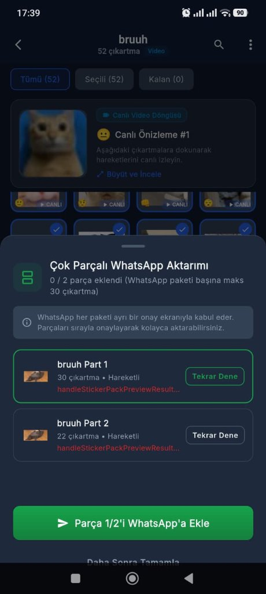
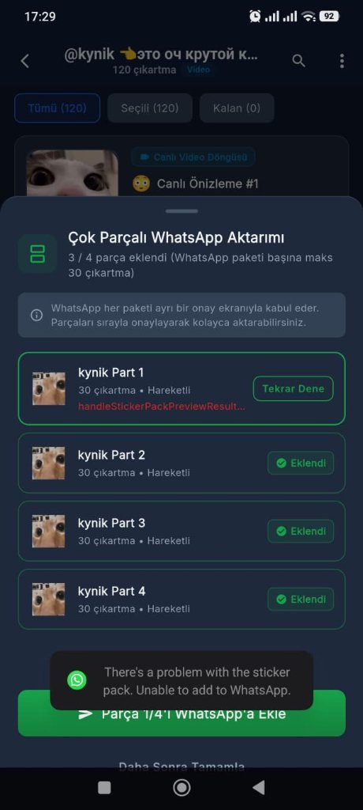

# StickerSwap - Geliştirici Notları & Yol Haritası (Developer Notes & Roadmap)

---

## 🇹🇷 Türkçe (Turkish)

### 1. Çıkartmalar İlk Kez İndirilip Hazırlanırken Uygulamanın Donması / Yanıt Vermemesi (Optimizasyon İhtiyacı)
- **Öncelik:** 🔴 **YÜKSEK (1. Öncelik)**
- **Durum:** 🧪 **TEST EDİLECEK**
- **Sorun Tanımı:**
  - Donma ve kilitlenme sorunu WhatsApp ekranı açıldığında değil; **kullanıcı paket linkini verip çıkartmaları seçtikten sonra *"WhatsApp'a Aktar"* işlemini ilk başlattığı anda** gerçekleşmektedir.
  - Uygulama bu aşamada çok parçalı veya tekil tüm çıkartmaları (özellikle 30, 50, 120 adet veya hareketli/video WebM) Telegram sunucularından **tek tek çekmeye, karelerini ayrıştırmaya ve dönüştürmeye başladığında** arayüz tamamen donmakta, dokunmatik yanıtsız kalmakta, ilerleme göstergesi takılmakta ve cihazda "Uygulama Yanıt Vermiyor" (ANR) uyarısı oluşma riski doğmaktadır.
- **Tespit Edilen Kök Nedenler:**
  1. **Ana UI Isolate Üzerinde Yoğun CPU Tüketimi (Main Thread Blocking):**
     - Çıkartmaların indirilip yerel olarak hazırlandığı bu ön hazırlık evresinde `StickerProcessor` sınıfındaki görsel işleme operasyonları (`img.decodeImage`, `_fitImage`, `img.compositeImage`, `img.encodeWebP`) Flutter'ın ana UI iş parçacığında (main isolate) senkron çalıştırılmaktadır.
     - Her video çıkartma için Android `MediaCodec` motorundan 18 ham kare çekilmekte; bu 18 karenin her biri ana isolate'te tek tek decode edilip 512x512 canvas'a çizilmekte ve `package:image` saf Dart motoruyla çok katmanlı döngüde (kalite %75, %60, %45, %30) tekrar tekrar WebP olarak sıkıştırılmaktadır.
     - Tek bir video çıkartmanın kodlanması CPU'da 1-3 saniye sürdüğünden, 30 ila 120 çıkartmanın tek tek çekilip işlenmesi ana iş parçacığını dakikalarca kilitli tutmaktadır.
  2. **Seri İndirme ve İşleme Sıralaması (Sequential Pipeline Bottleneck):**
     - Telegram'dan ağ üzerinden tek tek indirme (`downloadSticker`) ile CPU tabanlı görüntü kodlama adımları art arda (sequential) tek bir döngüde çalıştırılmaktadır. Ağ beklemesi ile CPU iş yükünün birbirini bloklaması arayüzün askıda kalma süresini aşırı uzatmaktadır.
  3. **Bellek Şişmesi ve Çöp Toplayıcı (GC) Baskısı:**
     - Onlarca çıkartma işlenirken açılan büyük çözünürlüklü `Image` nesneleri ve ham bayt dizileri RAM'de birikmekte, sistem sık sık Garbage Collection (GC) tetikleyerek arayüzün tamamen duraksamasına yol açmaktadır.

- **Yapılacak Optimizasyonlar & Eylem Planı:**
  - [x] **Arka Plan Isolate (Worker Threads) Entegrasyonu:** Ağır görsel çözme, boyutlandırma ve WebP kodlama adımları `Isolate.run` ile arka plan worker iş parçacıklarına taşındı. Ana UI iş parçacığı serbest bırakılarak 60/120 FPS akıcılık korundu; isolate işi bitince RAM çöp toplayıcı yükü olmadan otomatik temizlendi.
  - [x] **Boru Hattı (Pipelined Concurrent Processing):** İndirme (I/O bound) işlemi ile görüntü işleme (CPU bound) eşzamanlı çalışacak şekilde kuyruk yapısına (3 eşzamanlı worker) alındı. Çıkartmalar paralel olarak indirilip işlenmekte, sıraları bozulmadan WhatsApp paketlerine aktarılmaktadır.
  - [x] **WebP Kodlama Performansının İyileştirilmesi:** Android tarafında donanım hızlandırmalı yerel WebP sıkıştırma API'si (`compressStaticWebP`) entegre edildi. Dart tarafında ise kare sayısı ve ilk geçiş kalite oranı (q:70) optimize edilerek gereksiz tekrarlı kodlama döngüleri engellendi.
  - [x] **Kullanıcı Geri Bildirimi ve Akıcı İlerleme Görselleştirmesi:** Çıkartmalar hazırlanırken gerçek zamanlı yüzde (`%XX`), mevcut durum (`Hazırlanıyor: X / Y çıkartma`) `TweenAnimationBuilder` ile akıcı animasyonla gösterilmekte; kullanıcıya anında güvenli "İşlemi İptal Et" seçeneği ve sayfa çıkışında `PopScope` koruması sunuldu.

---

### 2. Bazı Çıkartmaların WhatsApp'a Eklenememesi & Hata Vermesi (`handleStickerPackPreviewResult`)
- **Öncelik:** 🔴 **YÜKSEK (2. Öncelik)**
- **Durum:** ⏳ **YAPILACAK / İNCELENİYOR**
- **Sorun Tanımı:**
  - Çok parçalı veya tekil çıkartma paketleri WhatsApp'a eklenirken bazı parçalar sorunsuz eklenirken (örn. `@kynik` paketinin Parça 2, 3 ve 4'ü başarıyla eklendi), bazı parçalarda (örn. `@kynik Part 1` ve `bruuh Part 1, Part 2`) ekleme işlemi başarısız olmaktadır.
  - Uygulama içinde ilgili parçanın altında kırmızı renkli `handleStickerPackPreviewResult...` hata mesajı listelenmekte, WhatsApp tarafında ise *"There's a problem with the sticker pack. Unable to add to WhatsApp."* (Çıkartma paketinde bir sorun var. WhatsApp'a eklenemiyor.) sistem uyarısı (toast) çıkmaktadır.

- **Örnek Hata Ekran Görüntüleri:**
  | `bruuh` Paketi: Parça 1 ve 2 Hata Aldı | `@kynik` Paketi: Parça 1 Hata Aldı, Parça 2-4 Eklendi |
  | :---: | :---: |
  |  |  |
  | *Görsel 1: `bruuh` video paketinde her iki parça da `handleStickerPackPreviewResult` hatasıyla başarısız oldu.* | *Görsel 2: `kynik` paketinde 2, 3 ve 4. parçalar onaylanırken 1. parçada WhatsApp "There's a problem with the sticker pack" uyarısıyla reddetti.* |

- **Tespit Edilen Olası Kök Nedenler & WhatsApp Doğrulama (Validator) Kuralları:**
  WhatsApp'ın yerel `AddThirdPartyStickerPackActivity` ve `StickerPackValidator` modülleri çıkartma paketlerini içeri alırken çok katı kurallarla doğrular. Parça içindeki tek bir çıkartmanın bile kural dışı olması tüm parçanın reddedilmesine yol açar:
  1. **500 KB Boyut Sınırı Aşımı (Animated WebP Size Limit):**
     - WhatsApp hareketli çıkartmalar için dosya başına kesinlikle en fazla **500 KB** (500 * 1024 = 512,000 bayt) limit koymuştur.
     - `StickerProcessor` içindeki çoklu kalite düşürme adımlarına rağmen bazı karmaşık video karelerinde oluşan WebP dosyası 500 KB sınırını kıl payı aşmış ve WhatsApp doğrulayıcısına takılmış olabilir.
  2. **Animasyon Süresi ve Kare Hızı Kısıtlamaları:**
     - WhatsApp spesifikasyonuna göre hareketli çıkartmaların toplam süresi **en fazla 3000 ms (3 saniye)** olmalı, her bir karenin gösterim süresi ise **en az 8 ms** olmalıdır. Ayrıca animasyon sonsuz döngü (`loop count = 0`) yapmalıdır.
  3. **Emoji Doğrulama ve Format Sorunları (Max 3 Emojis):**
     - WhatsApp kuralı: Her çıkartma için **en az 1, en fazla 3 geçerli Unicode emojisi** bildirilmelidir.
     - Telegram çıkartmalarından gelen emojiler arasında görünmez karakterler, birleşik varyasyon seçiciler veya 3'ten fazla emoji bulunduğunda WhatsApp paketi reddeder. `pack_preview_screen.dart` dosyasında `[sticker.emoji]` kontrolsüz iletilmektedir.
  4. **Tepsi Simgesi (Tray Icon) İhlali ve Dosya Üzerine Yazma (Collision):**
     - WhatsApp tepsi simgesinin kesinlikle **96x96 piksel, PNG formatında ve 50 KB altında** olmasını şart koşar.
     - Çok parçalı aktarımda tüm parçalar aynı dizindeki tek bir `tray_icon.png` dosyasını kullanmakta ve birbirinin üzerine yazmaktadır. İlk parçanın tepsi simgesi henüz okunurken dosyanın değişmesi veya geçersiz kalması 1. parçaların hata almasına zemin hazırlamaktadır.
  5. **WhatsApp Dahili Hata İletişimi:**
     - WhatsApp, hata durumunda `validation_error` extra alanında doğrudan iç metot adı olan `handleStickerPackPreviewResult` veya muğlak bir mesaj dönmektedir.

- **Yapılacak İyileştirmeler & Eylem Planı:**
  - [ ] **Sıkı Dosya Boyutu Koruması (Strict 480 KB Ceiling):** Kodlanan her WebP'nin boyutu kaydedilmeden önce kesin olarak denetlenecek; 480 KB'ı aşan durumlarda kare sayısı veya çözünürlük kademeli düşürülerek 500 KB sınırının aşılması imkânsız kılınacak.
  - [ ] **Emoji Filtreleme & Standartlaştırma (1-3 Emoji Sanitization):** Çıkartma emojileri taranacak; geçersiz karakterler ayıklanacak, maksimum 3 emoji sınırına kırpılacak ve boş olanlar için varsayılan güvenli emoji ("⭐") atanacak.
  - [ ] **Parça Başına Benzersiz Tepsi Simgesi (Unique Tray Icon per Part):** Her parça için bağımsız `tray_part_1.png`, `tray_part_2.png` dosyaları oluşturulacak; 96x96 ve < 50 KB PNG formatı garanti altına alınacak.
  - [ ] **Detaylı Hata Ayıklama (Logcat & Contextual Error Parsing):** WhatsApp'ın reddettiği çıkartmanın dosya boyutu, çözünürlüğü ve emojisi loglanarak hata mesajı kullanıcıya anlaşılır şekilde sunulacak.

---
---

## 🇬🇧 English (Developer Summary)

### 1. App Freezing & Unresponsiveness During Initial Bulk Sticker Download & Preparation (Optimization Needed)
- **Priority:** 🔴 **HIGH (Item 1)**
- **Status:** 🧪 **READY FOR TESTING**
- **Issue:** The freeze does *not* occur when WhatsApp itself opens; rather, it happens **immediately when the user provides the pack link, selects stickers, and first taps *"Export to WhatsApp"***. At this stage, the app fetches each sticker from Telegram servers one by one, extracts video frames, and converts them to Animated WebP locally. During this sequential bulk preparation process, the main UI thread completely freezes, touch becomes unresponsive, progress freezes, and there is a high risk of an ANR (Application Not Responding) dialog.
- **Root Causes:**
  1. **Main UI Isolate Blocking:** CPU-heavy decoding, canvas composition, and WebP encoding in `StickerProcessor` run synchronously on Flutter's main thread during this preparation loop.
  2. **Sequential Pipeline Bottleneck:** Downloading stickers from Telegram one by one and sequentially processing each one locks the UI for minutes (especially on 30-120 sticker packs).
  3. **High Memory & GC Pressure:** Heavy frame allocation and decoding creates frequent garbage collection pauses and interface lockups.
- **Action Items Completed:**
  - [x] Offloaded heavy image operations to background Dart Isolates (`Isolate.run`) so the UI remains fluid at 60/120 FPS during preparation, with intermediate buffers cleanly freed upon worker completion.
  - [x] Implemented concurrent downloading and processing pipelines (bounded concurrency pool of 3 workers), overlapping I/O and CPU workloads without changing sticker order.
  - [x] Implemented hardware-accelerated native Android WebP compression (`compressStaticWebP`), and optimized Animated WebP encoding passes and frame counts.
  - [x] Implemented smooth real-time progress visualization with `TweenAnimationBuilder`, an immediate "İşlemi İptal Et" cancellation action, and `PopScope` exit protection.

---

### 2. Sticker Pack Import Failures in WhatsApp (`handleStickerPackPreviewResult`)
- **Priority:** 🔴 **HIGH (Item 2)**
- **Status:** ⏳ **TODO / INVESTIGATING**
- **Issue:** Certain pack parts fail to import into WhatsApp with the error `handleStickerPackPreviewResult...` and a native toast saying *"There's a problem with the sticker pack. Unable to add to WhatsApp"*, while other parts in the same pack succeed (e.g. `@kynik Part 1` failed, but Parts 2, 3, and 4 succeeded).
- **Screenshots:**
  - `assets/screenshots/error_bruuh_preview_result.jpg` (`bruuh` Parts 1 & 2 failed)
  - `assets/screenshots/error_kynik_whatsapp_validation.jpg` (`kynik` Part 1 rejected by WhatsApp validator)
- **Suspected Causes:**
  1. **Animated WebP > 500 KB:** Complex frames exceeding WhatsApp's strict 500 KB limit.
  2. **Duration / FPS Limits:** Animations must be $\le 3000\text{ ms}$, frame duration $\ge 8\text{ ms}$, and loop count 0.
  3. **Emoji Validation:** Missing, malformed, or $> 3$ emojis per sticker.
  4. **Tray Icon Collisions:** Multi-part exports overwrite a single `tray_icon.png` in the shared directory.
- **Action Items:**
  - Enforce strict size guards ($\le 480\text{ KB}$) by downscaling resolution or reducing frames.
  - Sanitize sticker emojis (ensure 1 to 3 valid Unicode emojis).
  - Generate unique tray icons per part (`tray_part_X.png`) strictly sized at 96x96 PNG ($< 50\text{ KB}$).
  - Improve error reporting from WhatsApp's intent result for transparent debugging.
